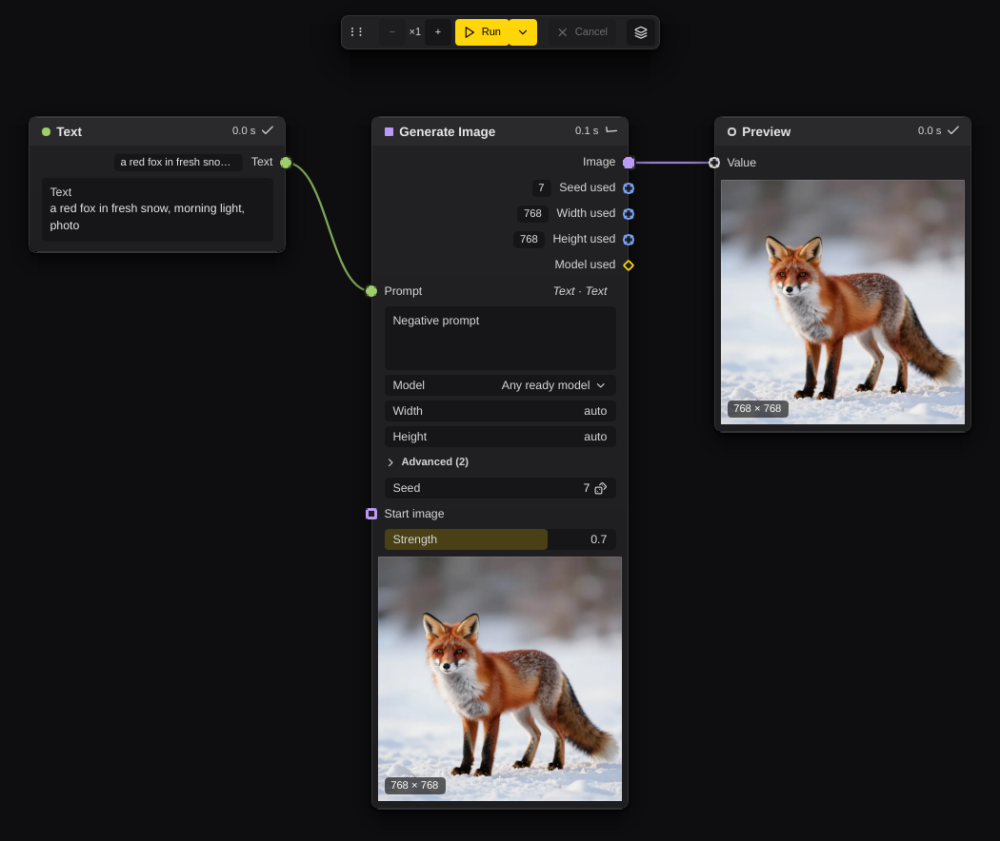
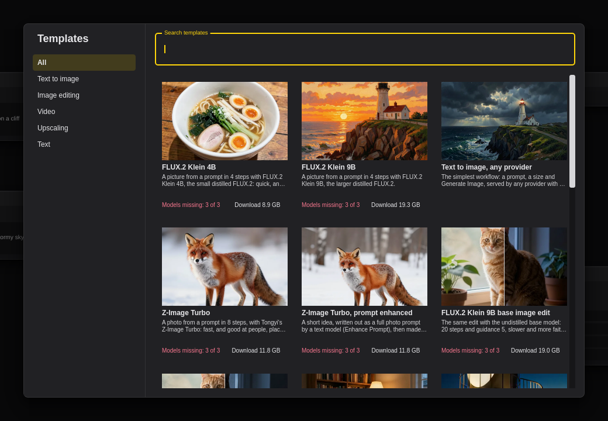
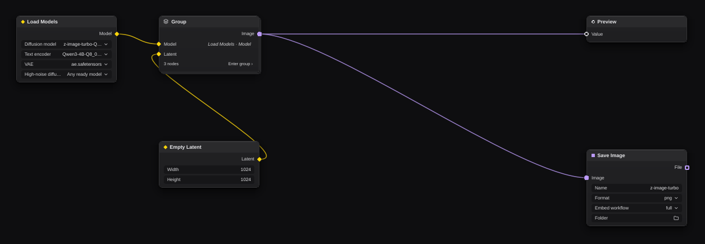
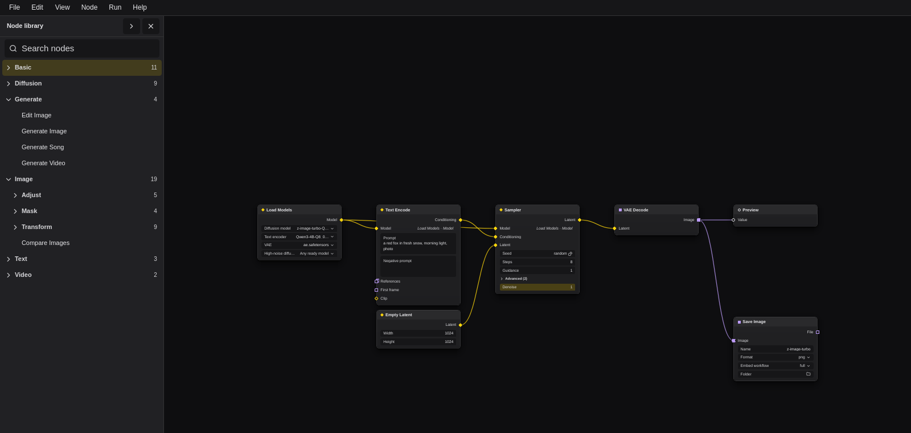

# Fugue

Node-based workflows for local AI on Omarchy, in C++ and Qt Quick.

Wire steps together (a prompt, an image, an edit, a clip, a song) and run the graph on the
models [omarchy-local-ai](https://github.com/omacom/omarchy-local-ai) serves, on this machine
or on a paired host. Add your own nodes as a folder with a `node.json` and a program, in any
language.

<p align="center"><picture>
  <source media="(prefers-color-scheme: light)" srcset="docs/images/hero-light.png">
  
</picture></p>

Fugue is at v0.1, a test release. The design is in [docs/spec.md](docs/spec.md) and the
vocabulary in [docs/GLOSSARY.md](docs/GLOSSARY.md).

## Install

On Arch Linux or Omarchy (x86_64 or aarch64), one command installs the latest release, or upgrades to it:

```sh
curl -fsSL https://raw.githubusercontent.com/bmaltais/fugue/main/install.sh | bash
```

It checks your system, picks the right packages (adding the CUDA helper on an NVIDIA machine), verifies them
against the release's `SHA256SUMS` and installs them with `sudo pacman -U`, so it asks for your password.
Read it first at [install.sh](install.sh); `bash -s -- --dry-run` shows what it would do and changes nothing,
`--version TAG` pins a release, `--no-cuda` skips the helper. Other ways to install are [below](#install-by-hand).

## A short tour

- **Canvas.** Place nodes, wire their ports, search for a node, undo, work in tabs and save.
  Run with Ctrl+Enter: each node shows its state, progress and results. Settings (Ctrl+,)
  apply live.

<p align="center"><picture>
  <source media="(prefers-color-scheme: light)" srcset="docs/images/results-light.png">
  
</picture></p>

<p align="center"><picture></picture></p>

- **Templates.** File > Browse templates lists ready-to-run workflows (text to image, image
  edits, prompt enhancing and more) with a preview each; open one and run it. The CLI does the
  same: `fugue template list`, `fugue workflow new <file> --template <id>`.

<p align="center"></p>

<p align="center"><picture> Browse templates, FLUX.2 Klein 4B opens, Run: the picture shows on the nodes" src="docs/images/tour-run-template.avif" width="720"></picture></p>

- **Groups.** Select nodes and make a group (Ctrl+Shift+E): it collapses into one reusable
  node with the inputs and outputs you choose, and can be entered, nested and ungrouped. Frames
  (Ctrl+G) are colored boxes that only organize the canvas. The node library (N) lists every
  node to drag in.

<p align="center"></p>

<p align="center"><picture></picture></p>

<p align="center"></p>

- **Masks and inpainting.** Paint over a picture (Paint mask on Load Image or the Paint Mask node) and
  redraw only that part, or extend a picture past its edges: the templates Inpaint: change a region
  and Outpaint: extend a picture run FLUX.2 Klein 9B, and the group Inpaint (crop and stitch) gives a
  small region the model's full detail with no seam. The mask editor is built in. See
  [docs/masking.md](docs/masking.md).
- **Canvases.** `fugue canvas new|import|export|log|show` keeps a layered picture as a chain of
  immutable revisions, stored as tiles; Canvas Region and Canvas Write read a region of it and put a result
  back as a new layer; the window comes next. See [docs/canvas.md](docs/canvas.md).

<p align="center"></p>

- **Providers as modules.** A provider is a folder with a `provider.json` in `~/.local/share/fugue/providers/<id>/`, speaking a small JSON protocol over HTTP or stdio (spec 8.8); no change to Fugue is needed to add one.
- **Local and paired-host runs.** The `omarchy` provider serves models from this machine and
  from every host paired through omarchy-local-ai, so one graph can use a model on another
  machine. Heavy generation runs in a separate helper process (stable-diffusion.cpp).
- **Share packages.** File > Export for sharing writes one `.fuguepack`: the workflow, its
  groups, the input images and a preview, with models kept as references (hash, source, size)
  the receiver downloads. From the CLI: `fugue workflow export <file> --share`. The desktop
  opens `.fuguepack` files with Fugue.
- **Agents.** Everything above works with no window and with `--json`, so an agent can build,
  validate, run and inspect workflows. `fugue skill install` teaches it how: one copy in
  `~/.agents/skills/fugue` (Pi and others) linked into Claude Code's skills folder; run it again to
  update, `--dry-run` to see where it writes, `fugue skill uninstall` to remove. It never
  overwrites a file you edited. Agents cannot install packs or start models: a person confirms.
- **Writing nodes.** A node is a program that speaks JSON over stdin and stdout, described by a
  `node.json`. Start with the [five-minute quickstart](docs/nodes/quickstart.md); the rest of
  the guide is in [docs/nodes](docs/nodes/README.md). Fugue enforces no sandbox: install packs
  you would run in a terminal.

## Install by hand

Fugue is packaged for Arch and Omarchy. Download the packages from the
[latest release](https://github.com/bmaltais/fugue/releases) and install:

```sh
sudo pacman -U fugue-*.pkg.tar.zst
```

Each release has the packages for x86_64 and for aarch64 (Arch Linux ARM, Asahi Linux); take the ones whose
file name ends in your architecture, for example `fugue-*-aarch64.pkg.tar.zst`.

For generation on an NVIDIA GPU, also install the helper with `fugue-helper-cuda-*.pkg.tar.zst`
(`sudo pacman -U fugue-helper-cuda-*.pkg.tar.zst`). The release includes `SHA256SUMS`.

This is a test release and the packages are unsigned.

## Docs

- [docs/spec.md](docs/spec.md): the design and behavior.
- [docs/nodes](docs/nodes/README.md): writing nodes and packs.
- [docs/GLOSSARY.md](docs/GLOSSARY.md): the vocabulary.
- [docs/ui-ergonomics.md](docs/ui-ergonomics.md): rules window UI follows.
- Research notes behind the big epics: [mesh](docs/mesh-research.md), [private mode](docs/private-mode-research.md), [canvas](docs/canvas-research.md), [workspaces](docs/workspaces-research.md); design notes: [canvas actions](docs/canvas-actions-design.md).
- [docs/recording-screenshots.md](docs/recording-screenshots.md): how the pictures above are made again.
- Work is tracked in the [issues](https://github.com/bmaltais/fugue/issues) by milestone.

## Build

The bundled templates are a submodule ([fugue-workflows](https://github.com/bmaltais/fugue-workflows)):
clone with `--recurse-submodules`, or run `git submodule update --init` once.

```sh
bin/build        # the app and the tests
bin/test         # builds, then runs every test (arguments go to ctest); a test running over 300 s fails
bin/build fugue  # only the app; any CMake target works, e.g. bin/build test_menus
```

The app is `build/fugue`.

The generation helper, stable-diffusion.cpp with Fugue's stage patch, builds on its own:

```sh
bin/build-helper cuda    # or vulkan, cpu; into build-helper-<backend>/
```

## License

MIT.
