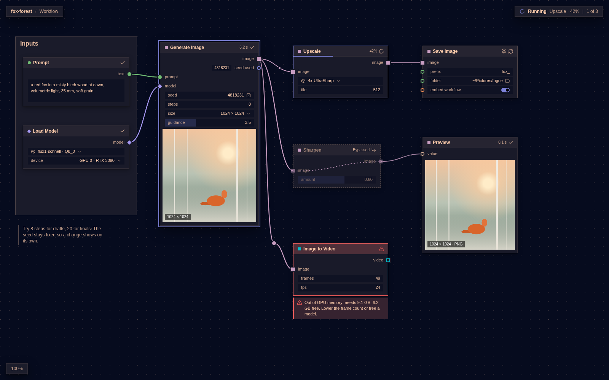

# Canvas look

Issue #47. Date: 2026-11-19. Status: **approved** by the owner; step 2 built it, with section
18's questions as recommended (what differs is in [spec Appendix A](spec.md#appendix-a-choices-made-in-this-document)).

[spec 12](spec.md#12-canvas) fixes how the canvas behaves, and its feel is approved. This document
fixes how it looks: every size, color, state and motion the restyle (#47 step 2, on top of #16)
builds. Everything derives from three theme inputs, the palette, `theme.radius` and
`theme.textSize`, so it holds on every Omarchy theme, light or dark, with square or round corners.

Mockups are in [canvas-look/](canvas-look/): open an `.html` file in a browser and pick a theme and
radius in the corner. Screenshots of each are in [canvas-look/shots/](canvas-look/shots/).
`canvas-look/derive.py` computes every color in this document, the mockups' colors and the
contrast table from the installed themes, so the three cannot drift apart.

| Mockup | Shows |
| --- | --- |
| [canvas.html](canvas-look/canvas.html) | A real workflow: frame, comment, selection, running, bypassed, error, reroute, thumbnails |
| [states.html](canvas-look/states.html) | Every node state side by side, and the port legend |
| [wires.html](canvas-look/wires.html) | Wire states, the drag reason chip, the three zoom tiers, frame, comment, breadcrumb, reroute |
| [search.html](canvas-look/search.html) | Node search from Tab, and from a dropped link |
| [overlay.html](canvas-look/overlay.html) | The `?` shortcuts overlay |



## 1. Principles

1. **The result is the loudest thing on a node.** A thumbnail, a value, a progress bar: what a
   node made outranks what it is. Chrome (headers, borders, labels) stays quiet. Learned from
   Substance 3D Designer, Krea Nodes and Figma Weave, where the preview is the node's face.
2. **Color means port type and nothing else.** Headers are neutral. States are glyphs, edges
   and opacity, with color only as a second signal. A layout color (spec 4.5) tints a header
   gently and never fights the type colors.
3. **One elevation order:** canvas, frame, node, selected node, popup. Dark themes lift a surface
   with a lighter fill; light themes with a white card and a soft shadow.
4. **Square corners are the main case.** Omarchy's default rounding is 0, and the owner runs it.
   Every radius is a function of `theme.radius`, and nested radii follow outer = inner + padding.
5. **Calm at rest, rich on intent.** Port marks on widget rows, wire highlights, the cut handle
   and the drag reasons appear on hover, selection or a drag, not all the time.
6. **Cheap by construction.** A node is a fixed, small set of items; shadows are one shared
   texture; nothing animates at idle; three zoom tiers shed detail (section 14).
7. **Familiar to a ComfyUI hand.** Same anatomy (title, outputs, inputs with widgets, preview) and
   keymap; better states, type cues and polish.

## 2. What the reference apps teach

The research was by pattern; no number below is copied from these apps (their docs publish none).

| App | Pattern taken | Where |
| --- | --- | --- |
| Substance 3D Designer | The thumbnail is the node's face; wires colored by type; compact chrome | 4.6, 8 |
| Unreal Blueprints and Material Editor | Hollow pin = unconnected, filled = connected; comment boxes whose titles stay readable when zoomed out; execution highlighted along wires during a run | 5, 8, 11 |
| Blender node editor | Outputs listed above inputs; widgets as full-width fields, label left and value right; a diamond socket shape; frames as flat tinted regions; reroute dots; a dark outline under links | 4, 5, 11 |
| Nuke | Dots (reroutes) and backdrops as first-class organisers; postage-stamp previews | 11 |
| Krea Nodes, Figma Weave | Content-first cards, generous previews, handles hidden until hover, quiet dot grid | 1, 5, 13 |
| n8n | Status badges on the node; a glowing outline while running; a cut handle at a wire's midpoint on hover; search-first insertion | 8, 9, 12 |
| ComfyUI (and Nodes 2.0) | Anatomy, keymap, widget rows; the baseline to beat | throughout |

## 3. Units, radius and type

`t` is `theme.textSize` (12 by default). One unit `u = t / 3` (4 px at 12). Sizes below are given
in `u` and in px at `t = 12`; round to whole pixels.

| Name | Value | At t = 12 |
| --- | --- | --- |
| `r`, node corner | `min(theme.radius, 8)` | 0 on Omarchy's default |
| `R`, popup corner | `theme.radius` | 0 |
| small corner (wells, chips, keycaps) | `min(r, 4)` | 0 |
| thumbnail corner | `max(0, r − 6)` | 0 |

| Role | Size | Weight | Color |
| --- | --- | --- | --- |
| Node title | `t` | DemiBold (600) | `text` |
| Port and widget label | `round(t × 11/12)` | Normal | `label` |
| Widget value | `round(t × 11/12)` | Medium (500) | `text` |
| Caption (time, status word, chips) | `max(9, round(t × 10/12))` | Normal | `label` |
| Frame title | `round(t × 4/3)` | DemiBold | `frame-<role>-title` |
| Search field | `round(t × 5/4)` | Normal | `text` |
| Search result name | `round(t × 13/12)` | DemiBold | `text` |
| Overlay title | `round(t × 3/2)` | DemiBold | `text` |

Liberation Sans, Qt's `sans-serif` here, has only Regular and Bold: Medium renders as Regular and
DemiBold as Bold, in Qt and in the mockups alike. The hierarchy must hold with those two weights,
which is why it leans on size and color as well. Numbers use tabular figures (`font.features: { "tnum": 1 }`), so times and percentages do not
jitter. The family is the application font (Qt's `sans-serif`, Liberation Sans on this machine);
the mockups use the same.

## 4. Node anatomy

```
 ┌───────────────────────────────────────┐  1 px hairline, corner r
 │ ■ Generate Image          6.2 s  ✓    │  header 7u: kind mark, title, meta
 ├───────────────────────────────────────┤
 │                          image  ■─────┼─ outputs first, right-aligned, 6u rows
 │              4818231   seed used  ○   │  last value as a chip
 ●──prompt                               │  wired input: label only
 │ ┌ steps ─────────────────────── 8 ┐   │  unwired input: a recessed well
 │ └─────────────────────────────────┘   │
 │ ┌─────────────────────────────────┐   │
 │ │          thumbnail              │   │  inset 1.5u, aspect kept
 │ └─────────────────────────────────┘   │
 └───────────────────────────────────────┘
```

### 4.1 Box

| Part | Value |
| --- | --- |
| Width | default 60u (240), minimum 40u (160), maximum 120u; auto-sized (longer text values widen it) until a resize pins it; a grip in the bottom right corner, 3u square, two short diagonals shown on hover and selection; double-click returns to auto |
| Edge | 1 px `hairline` inside the box; `hairline-strong` on hover |
| Fill | `body` |
| Corner | `r` (header top corners `r − 1` inside the edge) |
| Body padding | 1u above the first row, 2u below the last item |
| Shadow | level 1 (section 7) |

### 4.2 Header

| Part | Value |
| --- | --- |
| Height | 7u (28) |
| Fill | `header`; `tint-<role>` when the node has a layout color |
| Top highlight | dark themes only: a 1 px line of `text` at 6% along the top edge, inside |
| Padding | 3u left, 2.5u right; 1.5u between parts |
| Kind mark | 8 px: the shape and color of the node's first output type (a sink: its first input); a group shows the layers glyph instead |
| Title | elides at the right; the display title from layout when set |
| Meta (right) | caption text, then 14 px glyphs 1u apart: warnings, pin, state (section 9) |
| Progress | while running: 2 px bar along the header's bottom edge, `accent` on `hairline` |

### 4.3 Rows

Outputs come first, then inputs, one per 6u (24) row, as in Blender. No row holds two labels, so
widget wells can span the node, and the outputs sit next to the header where the eye starts.
**This changes port `y` in `canvas_model.cpp`, which owns port geometry** (see section 17).

| Part | Value |
| --- | --- |
| Output row | label right-aligned 3u from the edge; the last value, if any, as a chip 2u left of the label |
| Value chip | caption size, `text` on `well`, padding 0.25u 1.5u, small corner |
| Wired input | label left, 3u from the edge |
| Unwired input with a widget | a well across the row (section 4.4) |
| Port mark | centered on the node's edge (section 5) |

### 4.4 Widgets (spec 6.2)

An unwired input shows a recessed field: 3u in from both edges, 0.5u top and bottom (so 20 px
tall), `well` fill, small corner, 2u side padding. The label sits left in `label`; the value right
in `text`, Medium, elided.

| Widget | Inside the well |
| --- | --- |
| `spin` | value; ‹ › chevrons at the ends on hover; drag to scrub |
| `slider` | a fill from the left at `accent` 22% for the value's share of its range |
| `line` | value, elided at the right |
| `multiline` | 16u row (64); three lines at 16 px line height, `text`; scrolls when focused |
| `toggle` | a 22 × 12 switch at the right: `accent` track, `accentForeground` knob; off is `hairline-strong` |
| `choice` | value and a chevron-down glyph |
| `file`, `folder` | the path elided in the middle, a folder glyph |
| `color` | `#rrggbb` and a 12 px swatch |
| `seed` | value and a dice glyph (click: randomize, increment, fixed menu) |
| Model picker (resource inputs) | a model glyph, the model's name, a chevron |

### 4.5 Output values (spec 12.7)

| Output type | Shown |
| --- | --- |
| Image | thumbnail (4.6) |
| Video | thumbnail of the first frame, a play glyph centered, a duration chip (`0:04`) |
| Audio | a 10u waveform bar strip in the port color on `well` (from the peaks the engine reports) |
| Number | value chip in the output row |
| Text | an excerpt below the rows: `well`, small corner, two lines, `label` color |

### 4.6 Thumbnails

| Part | Value |
| --- | --- |
| Position | after the rows: 1.5u (6) in from the sides, 1u below the last row, the body's 2u padding under it |
| Size | width = node width − 3u; height from the image's aspect, clamped to 0.5 to 1.5 × width |
| Corner | `max(0, r − 6)`, so square on square themes and concentric on round ones |
| Fit | `Image.PreserveAspectFit` on `well`; a 16 px checkerboard of `well`/`hairline` under images with alpha |
| Outline | 1 px inside, white at 10% on dark themes, black at 10% on light (never a tinted color) |
| Info chip | bottom left, 1.5u in: `1024 × 1024`, caption size, white on black at 60% (it sits on the image, not the theme) |
| Loading | `asynchronous: true`, `sourceSize.width = min(512, 2 × displayed width)`, `mipmap: true`, `cache: false` |
| New result | cross-fades over the old one (150 ms); while a node runs, the previous result stays at 50% opacity |

Rounding an `Image` needs a mask: use one small `ShaderEffect` (a rounded-rect alpha in the fragment
shader, compiled with `qt_add_shaders`) only when the thumbnail corner is above 0. Never
`layer.enabled` or `MultiEffect` masking per thumbnail.

### 4.7 Error chip

Under a node in error, 1.5u below its edge, the node's width: `error-chip` fill, a 2 px `error`
rule on the left, small corner, padding 1.5u 2u, an alert glyph in `error`, and the message in
`text` at label size, two lines then elided. A click opens the error panel at that node's path id.

## 5. Ports (spec 12.6)

| Type | Shape | Color |
| --- | --- | --- |
| `text`, `number`, `boolean` | circle | `portColor(type)` |
| `image`, `video`, `audio` | square (corner `min(r, 2)`) | `portColor(type)` |
| a declared type | diamond (a square rotated 45°, 8 px across) | `portColor("declared")` |
| `any` (Preview only) | ring, 2 px | `label` |

| Aspect | Value |
| --- | --- |
| Size | 2.5u (10 px), centered on the node's edge |
| Hit area | at least 20 screen px (already `portAt` in #16) |
| Wired | filled, with a 2 px ring in `body` that separates it from the wire |
| Unwired | hollow: 2 px stroke in the type color, `body` inside |
| List | a second 1.5 px outline behind, offset (3, −3), at 70% |
| Widget input, unwired | hidden (opacity 0) until the node is hovered or a compatible link is dragged |
| Hover | scale 1.25 |
| Valid target while dragging | scale 1.4 and a 2 px `accent` ring outside a 2 px `body` gap |
| Invalid target while dragging | opacity 0.25 (as #16 does now) |
| Collapsed node | all inputs meet at the header's left end, all outputs at its right |

`PortDot.qml` already draws circle, square, diamond, ring and the list outline; it needs the
hollow state, the `body` separator ring and the hover and target scales.

## 6. Color

### 6.1 Canvas tokens

All from the theme, with `mix(a, b, k)` the straight sRGB blend `Theme::mix` already uses. On a
light theme the canvas steps a shade below the window so nodes can be lighter than it, the way
light design tools lay cards on a gray table.

| Token | Dark theme | Light theme | Use |
| --- | --- | --- | --- |
| `canvas` | `background` | `mix(background, text, .045)` | the canvas fill |
| `dot`, `dot-major` | `mix(canvas, text, .13 / .22)` | `mix(canvas, text, .15 / .24)` | grid dots |
| `body` | `mix(background, text, .075)` | `mix(background, white, .6)` | node fill |
| `header` | `mix(background, text, .13)` | `mix(body, text, .05)` | node header |
| `hairline` | `mix(background, text, .17)` | `mix(body, text, .13)` | node edge, dividers |
| `hairline-strong` | `mix(background, text, .30)` | `mix(body, text, .26)` | hover edge, keycaps, dashed edges |
| `well` | `mix(background, text, .035)` | `mix(body, text, .05)` | widget fields, value chips |
| `label` | `mix(body, text, k)`, k from .80, stepping up by .02 until it reads at 4.5:1 on `body`, `header`, `well`, `popup`, `selected-row` and `canvas` | the same from .87 | port and widget labels, captions, categories, comments |
| `popup` | `mix(background, text, .09)` | `body` | search, overlay, chips, pills |
| `error-header` | `mix(header, red, .20)` | `mix(header, red, .14)` | a node in error |
| `error-chip` | `mix(body, red, .14)` | `mix(body, red, .10)` | the error chip |
| `selected-row` | `mix(body, accent, .16)` | `mix(body, accent, .12)` | search highlight |
| `frame-<role>` | `mix(canvas, role, .10)` | `mix(canvas, role, .12)` | frame fill (opaque) |
| `frame-<role>-edge` | `mix(canvas, role, .35)` | same | frame edge |
| `frame-<role>-title` | `mix(role, text, k)`, k from .5, stepping up by .1 until 4.5:1 on the frame fill | same | frame title |
| `tint-<role>` | `mix(header, role, k)`, k = .18, stepping down by .04 until the title reads at 4.5:1 | same, from .14 | header of a colored node |
| `scrim` | black at 45% | black at 22% | behind the `?` overlay |

`text`, `accent`, `accentForeground` and `error` are the theme's own. The neutral role `muted`
uses `label` as its color. Theme roles for layout colors are the palette names (`blue`, `green`,
...), as spec 4.5 says.

`label` exists because `Theme::muted` (`mix(background, text, .65)`) reads at under 4.5:1 against
a node's body on 8 of the 23 themes, light and dark (lowest rose-pine, 3.18), too faint for 11 px
labels (question 3 in section 18).

### 6.2 Port colors

`Theme::portColor` today maps each type to a palette color (text green, number blue, boolean
orange, image magenta, video cyan, audio yellow, declared accent). Measured on Omarchy's 23 shipped
themes: in **18 of them two of the six built-in types are within OKLab distance 0.08** (hard to
tell apart), in **6 two are identical**, the accent equals another port color in nearly all of
them, and on light themes the colors fall to 2.2:1 against a node. Proposed resolution, in
`Theme`, in this order (`derive.py`'s `port_colors()` is the reference):

1. **Monochrome themes keep their grays** (no port color with OKLCH chroma ≥ 0.04: white,
   vantablack, solitude, last-horizon). Shape, fill and the row label carry the type there.
2. **Collisions are repaired.** In the order image, text, number, video, audio, boolean,
   declared, a type keeps its theme color unless it is gray or within 0.08 of one kept before
   it. Then it takes its fallback hue (text 145°, number 255°, boolean 55°, image 330°, video 205°,
   audio 90°, declared 290°), or the nearest hue in 30° steps that is distinct, at the theme's
   median port lightness and chroma (at least 0.12). A declared type with no distinct hue left
   takes `label`: its diamond already sets it apart.
3. **Lightness is lifted for contrast.** Each color's OKLCH lightness alone moves until it reads at
   3:1 against both `body` and `canvas` (non-text contrast), so marks and wires survive light
   themes. Hue and chroma stay the theme's.

The repair only touches what collides: on tokyo-night declared moves off the accent (which it
shared with number); on ethereal (the owner's theme) text, video and declared change.

### 6.3 Measured contrast

From `python3 docs/canvas-look/derive.py --table` (WCAG ratios; ΔE is the smallest OKLab distance
between any two of the seven port colors). "Label share" is the `k` the label rule settled on, and
"Label, worst surface" its lowest ratio across the six surfaces it is drawn on. Where the share
climbs toward 1 (everforest .98, gruvbox and tokyo-night .90), labels come close to `text` and the
hierarchy rests on size and weight.

| Theme | Mode | Title/header | Label share | Label, worst surface | Accent/canvas | Port/body (theme) | Port (lifted) | Port ΔE (theme) | Port ΔE (resolved) | Error/canvas | Text/error chip | Title/tinted header | Frame title/fill |
| --- | --- | --- | --- | --- | --- | --- | --- | --- | --- | --- | --- | --- | --- |
| catppuccin-latte | light | 7.06 | 0.87 | 4.62 (selected-row) | 4.07 | 2.49 | 3.00 | 0.00 | 0.10 | 4.50 | 6.43 | 5.88 | 4.60 |
| catppuccin | dark | 8.21 | 0.80 | 4.85 (selected-row) | 7.79 | 6.53 | 6.53 | 0.00 | 0.07 | 7.08 | 7.41 | 5.33 | 7.79 |
| ethereal | dark | 10.61 | 0.80 | 6.52 (selected-row) | 5.65 | 4.99 | 4.99 | 0.00 | 0.09 | 5.81 | 10.20 | 7.53 | 8.04 |
| everforest | dark | 5.51 | 0.98 | 4.58 (selected-row) | 5.74 | 4.57 | 4.57 | 0.00 | 0.08 | 4.55 | 5.18 | 4.62 | 5.29 |
| flexoki-light | light | 17.06 | 0.87 | 11.21 (selected-row) | 5.79 | 2.34 | 3.00 | 0.00 | 0.07 | 3.84 | 16.62 | 13.96 | 6.41 |
| gruvbox | dark | 6.12 | 0.90 | 4.53 (selected-row) | 5.94 | 4.58 | 4.58 | 0.00 | 0.07 | 4.70 | 5.80 | 4.58 | 5.64 |
| hackerman | dark | 12.78 | 0.80 | 6.52 (selected-row) | 15.05 | 6.14 | 6.84 | 0.03 | 0.09 | 13.92 | 10.66 | 8.05 | 10.21 |
| jade-horse | dark | 9.11 | 0.80 | 5.30 (selected-row) | 8.49 | 5.52 | 5.52 | 0.00 | 0.06 | 6.13 | 8.59 | 6.32 | 8.02 |
| kanagawa | dark | 8.16 | 0.82 | 4.58 (selected-row) | 11.26 | 3.77 | 3.77 | 0.04 | 0.08 | 3.22 | 8.52 | 6.18 | 6.41 |
| last-horizon | dark | 13.83 | 0.80 | 8.26 (selected-row) | 7.29 | 2.78 | 3.03 | 0.00 | mono | 6.83 | 13.12 | 8.72 | 8.39 |
| lumon | dark | 8.54 | 0.80 | 4.91 (selected-row) | 8.80 | 4.06 | 4.06 | 0.00 | 0.08 | 4.04 | 8.45 | 5.86 | 6.86 |
| lupine | light | 14.38 | 0.87 | 9.00 (selected-row) | 4.44 | 4.77 | 4.07 | 0.00 | 0.11 | 4.31 | 13.34 | 11.43 | 6.97 |
| matte-black | dark | 7.89 | 0.80 | 4.73 (selected-row) | 7.35 | 2.55 | 3.03 | 0.00 | 0.10 | 4.97 | 7.53 | 5.19 | 5.44 |
| miasma | dark | 6.63 | 0.82 | 4.66 (selected-row) | 3.86 | 2.56 | 3.03 | 0.00 | 0.07 | 2.30 | 6.90 | 5.36 | 4.87 |
| nord | dark | 6.58 | 0.82 | 4.54 (selected-row) | 4.64 | 3.63 | 3.63 | 0.00 | 0.08 | 3.05 | 6.78 | 4.87 | 5.60 |
| retro-82 | dark | 9.88 | 0.80 | 5.67 (selected-row) | 9.30 | 3.38 | 3.99 | 0.00 | 0.11 | 5.37 | 9.91 | 6.89 | 6.56 |
| ristretto | dark | 7.78 | 0.80 | 4.87 (selected-row) | 6.33 | 5.23 | 5.23 | 0.00 | 0.09 | 5.35 | 7.42 | 5.25 | 6.94 |
| rose-pine | light | 6.53 | 0.87 | 4.50 (selected-row) | 2.94 | 2.16 | 3.00 | 0.00 | 0.04 | 3.60 | 6.25 | 5.39 | 4.52 |
| solitude | dark | 8.83 | 0.80 | 5.67 (selected-row) | 4.70 | 3.27 | 3.27 | 0.00 | mono | 2.78 | 9.05 | 5.47 | 6.86 |
| starship | dark | 10.71 | 0.80 | 6.42 (selected-row) | 8.28 | 4.88 | 4.88 | 0.00 | 0.08 | 5.66 | 10.62 | 7.60 | 8.29 |
| tokyo-night | dark | 6.31 | 0.90 | 4.54 (selected-row) | 6.79 | 4.73 | 4.73 | 0.00 | 0.08 | 6.46 | 5.67 | 4.59 | 6.11 |
| vantablack | dark | 16.07 | 0.80 | 9.72 (selected-row) | 6.33 | 5.59 | 5.59 | 0.00 | mono | 8.42 | 14.86 | 10.95 | 11.29 |
| white | light | 18.80 | 0.87 | 13.80 (selected-row) | 4.62 | 8.86 | 4.62 | 0.00 | mono | 13.00 | 17.41 | 14.16 | 11.52 |

What still falls short, and what covers it:

- **Accent against the canvas on rose-pine, 2.94:1.** The selection ring is also 2 px against a
  1 px edge, with a 2 px gap, and raises the shadow: thickness and elevation carry it.
- **Error against the canvas on miasma (2.30) and solitude (2.78).** An error node also has the
  alert glyph, a tinted header and the error chip with its message in `text`.
- **Resolved ΔE under 0.08 on six themes** (lowest rose-pine, 0.04, after the lift moved two
  colors together). There the shape and the row label carry the type, as on monochrome themes.

## 7. Elevation and shadows

| Level | What | Dark theme | Light theme |
| --- | --- | --- | --- |
| 0 | canvas | `canvas` | `canvas` |
| 0.5 | frame | `frame-<role>`, no shadow | same |
| 1 | node at rest | `body` + y 1 blur 2 black 45%, y 4 blur 12 black 30% | `body` + y 1 blur 2 black 7%, y 3 blur 10 black 7% |
| 2 | node selected or dragged; pills | y 2 blur 6 black 50%, y 12 blur 32 black 45% | y 2 blur 4 black 8%, y 10 blur 28 black 14% |
| 3 | search, overlay, menus, reason chip | `popup` + y 6 blur 16 black 50%, y 20 blur 56 black 55% | `popup` + y 4 blur 10 black 8%, y 18 blur 48 black 20% |

On dark themes the shadow mostly reads as a soft edge; the lighter fill does the lifting.

Spec 12.1 rules out costly effects on nodes at scale. A shadow here is not an effect: it is one
pre-painted texture shared by every node, drawn in one batch, off below the readable zoom, with a
measured budget and a fallback (below). If the measurement fails the budget, nodes at rest lose
their shadow and 12.1 wins.

**How, in QML.** C++ (`look::shadowImage`) paints each shadow once into a small QImage: a
rounded rect of the node's corner, blurred, with the level's two layers, handed to QML as a
`data:` URL (`theme.look.shadow1` to `shadow3`; the plan was an image provider, which each
engine would have to register). Each node shows it through a `BorderImage` (9-slice) stretched to
the node plus the blur margin. All nodes at one level share one texture.

- Put the shadows in **their own `Repeater` over the node model, below the node `Repeater`**, so
  they are contiguous in the render order and batch into one draw call.
- Below the readable zoom (0.5) the shadow layer is `visible: false`.
- Never `MultiEffect`, `layer.enabled` or a `DropShadow` per node.
- Budget: the shadow layer adds at most 1 ms of render-thread time at 300 nodes, measured with
  `QSG_RENDER_TIMING=1` as in spike 05. If it costs more, drop level 1 and keep level 2 for the
  selection only. Measured after step 2 (`test_canvas_window benchmark`, 302 nodes, 600 wires,
  RTX 3090): 0.45 ms at most, so nodes at rest keep their shadow.

## 8. Wires

### 8.1 Geometry

A cubic from the output's center to the input's center, both tangents horizontal:

```
dx = (b.x − a.x ≥ 6u)  ? clamp((b.x − a.x) × 0.5, 6u, 40u)
                        : 12u + min(|b.x − a.x|, 100u) × 0.25    // a backward link loops out and back
path: M a  C (a.x + dx, a.y) (b.x − dx, b.y) b
```

Wires draw under the nodes; the wire being dragged draws over them. Through a reroute point the
path is two cubics with the same rule. A wire takes its output's type color (links join identical
types, spec 2.3; a link into `any` takes the source's color), so wires never need a gradient.

### 8.2 States

| State | Opacity | Width (world px) | Casing | Other |
| --- | --- | --- | --- | --- |
| Rest | 0.8 | 2 | none | |
| Attached to a selected node | 1 | 2.5 | 6 px in `canvas` under it | |
| Hovered (pointer within 6 screen px) | 1 | 2.5 | yes | an 18 px cut handle at the midpoint: `popup`, `hairline-strong` edge, an × glyph; a click removes the link |
| Dimmed (another link is being dragged) | 0.25 | 2 | none | |
| Into a running node | 1 | 2 | yes | a 7 px dot in the wire's color with a 2 px `canvas` ring travels the wire every 900 ms |
| Dragged, no target | 1 | 2.5 | yes | ends at the pointer |
| Dragged, valid target | 1 | 2.5 | yes | snaps to the port's center; the port shows its target state |
| Dragged, invalid target | 1 | 2.5 | none | dashed (6 on, 5 off) in `error`, and the reason chip |
| Hidden (`L`) | 0 | | | |
| Overview tier | 0.8 | 4 | none | about 1 screen px at zoom 0.25 |

**Reason chip.** At the pointer plus (14, 14) screen px: `popup` fill, 1 px `error` edge, corner
`min(R, 6)`, level 3 shadow, padding 1.25u 2.25u. A 14 px reason glyph in `error`, then the text
from `CanvasModel::dragProblem` at label size in `text`, with the two type names in DemiBold:
"**Number** can't connect to **Text**: no conversion in v0.1".

**Reroute point.** A 10 px dot in the wire's color with a 2 px `canvas` ring; 14 px on hover.

### 8.3 Cost rules

- A wire's color and width are constant at rest. States change **opacity** (free: an opacity
  node, no new geometry) and the casing.
- The casing is not a second path on every wire: a second `Repeater` over the **highlighted
  links only** (the selection's, the hovered one, the dragged one) draws the casings. At rest it
  has no items.
- Never bind `strokeWidth`, `strokeStyle` or a dash offset to zoom or to time. Each change
  re-tessellates that Shape; across 600 wires on every wheel step that is the CurveRenderer
  collapse spike 05 measured. Width changes only when the zoom tier changes.
- The running dot is one `Rectangle` per running wire in view, moved by a `PathInterpolator` over
  a `Path` with the wire's cubic, driven by a `NumberAnimation` that runs only while a run is in progress. No
  dash animation, no timers at idle.
- Hover hit-testing belongs in the model (distance to the cubic, sampled in 16 segments, only for
  wires whose bounding box holds the pointer), not in QML items per wire.

## 9. Node states (spec 10.3, 12.7)

Glyphs are [Lucide](https://lucide.dev) icons (ISC license), bundled as a subset icon font
(section 16) and drawn with `Text`, so they recolor for free and never fall back to another font.

| State | Edge | Header | Glyph (Lucide name) | Caption | Opacity | Other |
| --- | --- | --- | --- | --- | --- | --- |
| Cached (default) | `hairline` | `header` | `check`, `label` | time taken (`6.2 s`) | 1 | the quiet case: most nodes look like this |
| Hover | `hairline-strong` | | | | 1 | widget port marks appear |
| Selected | 2 px `accent` ring outside a 2 px gap, its outer corner `r + 4` (0 when `r` is 0) | | | | 1 | shadow level 2; attached wires highlight |
| Stale (would run) | `hairline` | | `refresh-cw`, `label` | none | 1 | |
| Running | `accent`, its opacity pulsing 1 to 0.45 | progress bar | `loader-circle`, rotating | percent | 1 | dots travel the incoming wires |
| Frozen | `hairline` | | `snowflake`, `text` | "Frozen" | 1 | |
| Error | 1 px `error` | `error-header` | `triangle-alert`, `error` | | 1 | error chip under the node (4.7) |
| Bypassed | dashed `bypass-edge` | `bypass-header` | `corner-down-right` | "Bypassed" | 1 (body `bypass-body`) | the node tinted magenta; a dashed line in the type color from the input to the output it feeds (spec 3.5) |
| Muted | `hairline` | | `ban` | "Muted" | 0.4 | the whole node faded, untinted; its outgoing wires 0.4 |
| Skipped | `hairline` | | `skip-forward` | "Skipped" | 0.6 | an upstream node is muted |
| Missing type | dashed `error` | title in `error`: the type id | `circle-help` | | 1 | ports kept from the file; a body line "Not installed. Find it in packs…" (spec 11.6) |
| Warning | | | `triangle-alert`, `label`, with a count | | 1 | the warnings in a tooltip |
| Pinned | | | `pin`, `label` | | 1 | |
| Collapsed | | header only, corner `r` all round | | | 1 | width fits the title plus 24u (kind mark, meta, padding), at most 60u; one port mark at each end |
| Group (a node type) | `hairline` | layers glyph for the kind mark | `layers` | | 1 | a second card offset (1u, 1u) behind it; a caption row "4 nodes · Tab to enter" |

**Bypassed and muted** (owner feedback 2026-11-19). ComfyUI's litegraph draws a bypassed node
(mode 4) in magenta (`#FF00FF`) at alpha 0.2 and a muted one (mode 2, "Never") at alpha 0.4, so
bypass is "see-through magenta" and mute is "faded". Fugue keeps the two apart the same way and
adds legibility: the whole node is **tinted** with the theme palette's `magenta` (so it follows
light and dark themes and any radius) and mute only fades.

- `bypass-body` = `body` mixed toward magenta, 26% stepping down to 6%; `bypass-header` = `header`
  mixed toward magenta, 40% stepping down to 10%. The share is the first that keeps the text at
  4.5:1 on it (the labels too, where the plain body allows it), so the title and labels stay at
  full opacity; the old 55% fade is gone because it failed that rule. `bypass-edge` = the magenta
  lifted to 3:1 against the canvas, as the 1 px dashed edge. Computed in `look::tokens`.
- It costs nothing extra: two fill colors and the dashed edge the state already had (the `decor`
  Loader); no overlay item, no opacity layer, no per-node effect. Muted is the node's `opacity`
  (0.4), as before.
- The dashed pass-through line in the type color stays: it reads on the tint and says where the
  value goes, which ComfyUI's plain wires do not.
- Distinct from the rest: mute has no tint and a solid edge; an error is red with a solid edge;
  a missing type is a dashed red edge with a note row.
- Menu names follow the state (spec 12.4): the bypassed node's menu says "Remove bypass" (ComfyUI's
  "Remove Bypass"), a muted one "Unmute", a collapsed one "Expand", a pinned one "Unpin".

A dashed edge in QML is a `Shape` with `strokeStyle: ShapePath.DashLine` around a `PathRectangle`
(with `radius`), created only for nodes in those states.

## 10. Frames, groups, comments, breadcrumb

- **Frame** (spec 5.1): a flat region. `frame-<role>` fill (opaque, no blending), 1 px
  `frame-<role>-edge`, corner `r`, no shadow, no header bar. Title at (3u, 2u), frame-title size,
  `frame-<role>-title`. Selected: the node's accent ring. A frame never looks like a node: no
  fill change on hover, no header.
- **Frame titles when zoomed out**: below zoom 1 the title's `font.pixelSize` is
  `round(t × 4/3) / zoom`, so it keeps its screen size and the frames become the map; in the map
  and overview tiers the title draws above the nodes on a `frame-<role>` backing. Frames are few,
  so the relayout per zoom step is cheap.
- **Group node** (spec 5.2): a stacked card (4.2, section 9), so it reads as "holds nodes" and is
  never mistaken for a frame.
- **Breadcrumb** inside a group: a pill 4u from the top-left corner, height 7u, `popup` fill,
  `hairline` edge, corner `min(R, 14)`, level 2 shadow: `workflow › ◈ Two-pass upscale`, the
  current level in `text` DemiBold, the parents in `label` and clickable.
- **Comment**: text only, `label` at size `t`, 16 px line height, a 2 px `hairline-strong` rule on
  its left, 2.5u from the text, at most 58u wide. No fill, no shadow.

## 11. Canvas furniture

- **Grid**: dots every 6u in world space, a major dot every 5th: 1.8 px `dot`, 2.4 px `dot-major`.
  Drawn by one full-viewport `ShaderEffect` (uniforms: world offset, zoom, colors), so it costs one
  draw call and nothing at idle. Minor dots fade out between zoom 0.5 and 0.35; below that only
  the major dots remain. Needs `Qt6::ShaderTools` and `qt_add_shaders` (installed here).
- **Marquee**: 1 px `accent` edge, `accent` at 10% fill.
- **Zoom and run pills**: like the breadcrumb, bottom left (zoom percent) and top right (run
  state: spinner, "Running", node and percent, "1 of 3").

## 12. Node search (spec 12.8)

| Part | Value |
| --- | --- |
| Surface | `popup`, 1 px `hairline`, corner `R`, level 3 shadow, width 120u (480), at most 70% of the window's height |
| Place | its top-left corner at the pointer (double-click, Tab with the pointer on the canvas, or the dropped link's end), kept inside the window; centered when opened without a pointer |
| Field | 11u tall: 16 px search glyph in `label`, the query at search-field size, an `Esc` keycap at the right; placeholder "Search nodes" in `label` |
| Type filter | from a dropped link: a chip under the field (the port mark, "Takes Image", an × to remove it), 6u tall, `hairline-strong` edge, corner `min(R, 12)` |
| List | 1.5u padding; rows 11u (44), corner `max(0, R − 6)` (concentric), 2.5u gap between parts |
| Row | a 7u tile (the kind mark at 10 px on its type color at 16% over `popup`; a group shows the layers glyph); the name at result size; under it category › subcategory · pack in `label`; at the right the port signature (input marks → output marks, 8 px) and `v2` in `label` |
| Matches | the matched letters in `accent` with a 1.5 px `accent` underline (two signals) |
| Highlight | `selected-row` on the current row; moves with ↑ ↓ instantly |
| Sections | "Recent", then by category: caption size, DemiBold, `label` |
| Footer | 8.5u: keycaps for ↑ ↓ Move and ↵ Add; the count at the right ("5 of 61") |
| Empty | "No node matches “foo”." and "Search looks at names, categories and port types." |
| Right to left | the popup mirrors (field, rows, chips); the canvas never does |

## 13. The `?` overlay (spec 12.4, 12.5)

Restyles `CommandUi.qml`'s flat list:

- `scrim` over the window; the card centered, `min(880, window − 12u)` wide, `popup`, corner
  `R`, level 3 shadow, padding 6u 7u 5u.
- Header: "Shortcuts" at overlay-title size, the note under it in `label`, a filter field at the
  right (8u tall, `well`, `hairline-strong` edge) that narrows the list as you type.
- Two columns, 9u apart, of groups by command prefix (Run, Node, Frame and group, File, Edit,
  View, Panels, Mouse). Group titles at caption size, DemiBold, `label`.
- Rows 7u (28): the description left, then the deviation badge ("added", "Omarchy": caption size,
  `hairline-strong` edge, corner `min(R, 8)`), then keycaps. A hairline under each row at 60%.
- Keycap: at least 5u square, 1 px `hairline-strong` edge with a 2 px bottom edge, `body` fill,
  corner `min(R, 4)`, label size, Medium.
- Not-built commands at 50% opacity.
- Footer: where the keymap file lives, and `?` or `Esc` to close.
- Mirrors right to left.

## 14. Zoom tiers

Keyed to #16's `readableZoom` (0.5) and half of it. A tier is an integer property computed from
the zoom; everything below binds to the tier, never to the zoom itself.

| Tier | Zoom | Nodes | Wires | Frames | Shadows, grid |
| --- | --- | --- | --- | --- | --- |
| Full | ≥ 0.5 | everything | 2 px, states as above | title scales with zoom (constant screen size below 1) | on; all dots |
| Map | 0.25 to 0.5 | box, header fill, port marks, thumbnails; no text, wells or glyphs | 2 px; no casing, no hover | title above nodes | off; minor dots fade out by 0.35 |
| Overview | < 0.25 | box, header fill, thumbnails; no port marks | 4 px, rest state only | title above nodes | off; major dots only |

Thumbnails stay in every tier: at a distance a graph is recognised by its images, as in Substance.

**Per-node item budget** at the full tier (a 3-output, 5-input node with a thumbnail): box, header,
bevel, kind mark, title, meta (up to 3 glyph `Text`s and a caption), and per row a label, a port
mark and at most one well with two texts and a glyph. Rows are made lazily when first in view at
a readable zoom, as #16 already does; keep that.

## 15. Motion

| What | Duration | Easing | Property |
| --- | --- | --- | --- |
| Hover edge, port grow, handle appear | 100 ms | out-cubic | color, scale, opacity |
| Selection ring, wire highlight | 0 ms | | instant: high frequency |
| Widget port marks appear on hover | 120 ms | out-cubic | opacity |
| Search and overlay open | 140 ms | `Easing.BezierSpline [0.2, 0, 0, 1, 1, 1]` | opacity 0 → 1, scale 0.97 → 1 from the pointer |
| Search and overlay close | 90 ms | out-cubic | opacity |
| Reason chip | 80 ms | linear | opacity |
| New thumbnail | 150 ms | out-cubic | cross-fade |
| Running edge pulse | 1600 ms per half cycle | in-out-sine, alternating | edge opacity |
| Running spinner | 900 ms per turn | linear | `RotationAnimator` (render thread) |
| Running wire dot | 900 ms per pass | linear | `PathInterpolator.progress` |
| Theme change | 0 ms | | no transitions run while colors swap |

A "Reduce motion" setting (off by default) stops the pulse, the spinner's rotation and the wire
dots, and makes the popups appear without scale; the progress bar, glyphs and captions carry the
same information. Nothing animates when no run is in progress (spec 12.1: no CPU at idle).

## 16. Glyphs

A subset of Lucide (ISC) as an icon font in the resources, loaded with `FontLoader`, drawn with
`Text { font.family: icons.name; text: "\ue..." }`: check, refresh-cw, loader-circle, snowflake,
triangle-alert, corner-down-right, ban, skip-forward, circle-help, pin, layers, dices,
chevron-down, chevron-left, chevron-right, folder, box, search, circle-x, x, play. About 22 glyphs,
under 10 KB. Text glyphs recolor through `color`, render through the same distance-field text as
labels and batch with them; an SVG `Image` would need a separate texture per color.

## 17. What step 2 changes

Most of it is in #16's files, which step 2 restyles once #16 lands:

- `src/theme.cpp`, `theme.h`: the canvas tokens of 6.1 as properties (or one `canvas` map), the
  port color resolution of 6.2, the shadow images (built in `src/look.cpp`, as `data:` URLs).
  Tests: the tokens and port colors against `derive.py`'s values for a light, a dark and a
  monochrome theme.
- `canvas_model.cpp`: header 7u and rows 6u from `textSize` instead of the fixed 26 and 22;
  outputs before inputs in port `y`; the multiline widget's taller row; wire hover hit-testing.
- `CanvasNode.qml`, `PortDot.qml`, `FugueCanvas.qml`: anatomy, states, wells, thumbnails, the
  shadow and casing layers, the tier property, the grid shader.
- `CommandUi.qml`: the overlay of section 13.
- `CMakeLists.txt`: `Qt6::ShaderTools` for the grid and thumbnail shaders; the icon font in the
  resources. ShaderTools is a new build dependency: add it to CI's packages and to the
  `makedepends` of the PKGBUILD in `packaging/`.

Measure before and after with spike 05's method at 300 nodes and 600 wires (pan, and drag a node);
the target stays 12.1's.

## 18. Questions for the owner

Step 2 builds all five as recommended. The owner confirmed question 3 (`Theme::muted` stays as
it is); 1, 2, 4 and 5 are not yet recorded in the owner's own words.

1. **Port colors that collide.** Repair them in `Theme::portColor` as 6.2 describes (keep theme
   colors that are distinct, replace only the colliding ones), or always use the theme's colors
   as they are? *Recommended: repair.* On 18 of 23 themes two types are near-identical today.
2. **Monochrome themes.** Keep their grays and let shape, fill and the label carry the type, or
   bring in hues anyway? *Recommended: keep the grays,* the user chose a colorless theme. Image,
   video and audio are all squares there, told apart by the row label and the hover name.
3. **The label color.** Add canvas tokens to `Theme` (with `label` stepped to 4.5:1 on its surfaces, 6.1) and leave
   `Theme::muted` as it is, or raise `Theme::muted` itself for every screen? *Recommended: add the
   canvas tokens now, and move `muted` to the same values in a separate change* once other screens
   are checked against it.
4. **Outputs above inputs.** Blender's order (outputs first, each row one port), or ComfyUI's
   (inputs and outputs side by side on the same rows)? *Recommended: outputs first.* Wells can
   span the node, nothing shares a row, and outputs sit by the title. It costs one row per output.
5. **Light themes: canvas a shade darker than the window** so nodes can be white cards on it.
   *Recommended: yes;* the alternative (nodes darker than the canvas) looks dull and inverts the
   elevation order.

## 19. Regenerating

```sh
python3 docs/canvas-look/derive.py --table    # the table in 6.3
python3 docs/canvas-look/derive.py --write    # refresh tokens and shared code in the mockups
```

The mockups' shared CSS and JavaScript live in `canvas-look/src/`; `--write` inlines them so each
`.html` file stays self-contained. Screenshots: headless Chromium at 1600 × 1000,
`file://…/canvas.html#theme=ethereal&r=0&shot`.
