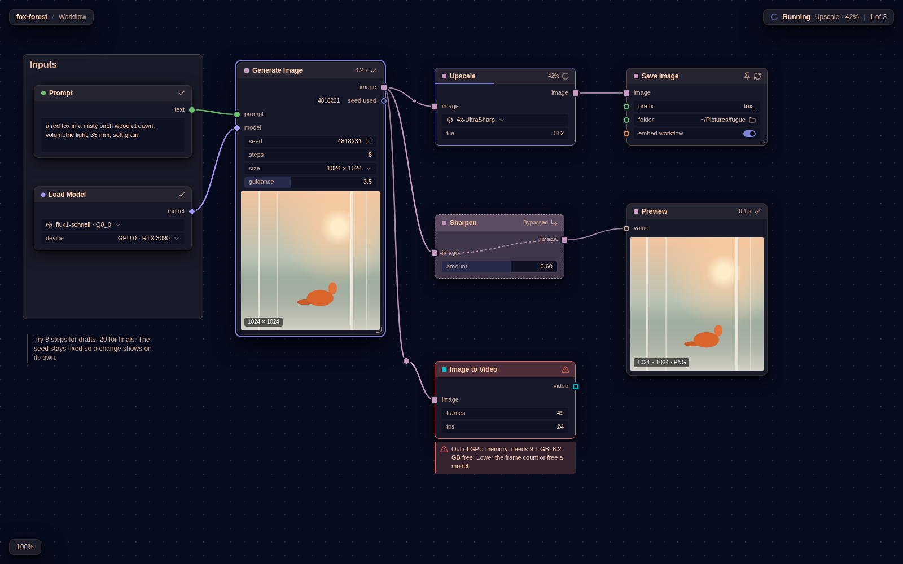

# Canvas look

Issue #47. Date: 2026-11-19. Status: **approved** by the owner; step 2 built it, with section
18's questions as recommended (what differs is in [spec Appendix A](spec.md#appendix-a-choices-made-in-this-document)).

[spec 12](spec.md#12-the-graph) fixes how the canvas behaves, and its feel is approved. This document
fixes how it looks: every size, color, state and motion the restyle (#47 step 2, on top of #16)
builds. Everything derives from three inputs, the theme's palette, the corner radius setting and
`theme.textSize`, so it holds on every Omarchy theme, light or dark, with square or round corners.
#63 (2026-11-20) made corners 8 px by default, retuned the shadows and let every corner resize.

Mockups are in [canvas-look/](canvas-look/): open an `.html` file in a browser and pick a theme and
radius in the corner. Screenshots of each are in [canvas-look/shots/](canvas-look/shots/).
`canvas-look/derive.py` computes every color in this document, the mockups' colors and the
contrast table from the installed themes, so the three cannot drift apart.

| Mockup | Shows |
| --- | --- |
| [canvas.html](canvas-look/canvas.html) | A real workflow: frame, comment, selection, running, bypassed, error, reroute, thumbnails |
| [states.html](canvas-look/states.html) | Every node state side by side, and the port legend |
| [wires.html](canvas-look/wires.html) | Wire states, the drag reason chip, the three zoom tiers, frame, comment, breadcrumb, reroute |
| [search.html](canvas-look/search.html) | Node search from Tab, and from a dropped link |
| [overlay.html](canvas-look/overlay.html) | The `?` shortcuts overlay |



## 1. Principles

1. **The result is the loudest thing on a node.** A thumbnail, a value, a progress bar: what a
   node made outranks what it is. Chrome (headers, borders, labels) stays quiet. Learned from
   Substance 3D Designer, Krea Nodes and Figma Weave, where the preview is the node's face.
2. **Color means port type and nothing else.** Headers are neutral. States are glyphs, edges
   and opacity, with color only as a second signal. A layout color (spec 4.5) tints the whole
   node, header and body, as ComfyUI's node colors do (#72), gently enough that text, labels and
   the type colors still read.
3. **One elevation order:** canvas, frame, node, selected node, popup. Dark themes lift a surface
   with a lighter fill; light themes with a white card and a soft shadow.
4. **Round corners by default, any radius holds.** Corners are 8 px unless the corner radius
   setting (General page) says otherwise: 0 to 16 px, or "Follow Omarchy" (Hyprland's rounding, 0
   on Omarchy's default). Every radius is a function of `r`, and nested radii follow
   outer = inner + padding.
5. **Calm at rest, rich on intent.** Port marks on widget rows, wire highlights, the cut handle
   and the drag reasons appear on hover, selection or a drag, not all the time.
6. **Cheap by construction.** A node is a fixed, small set of items; shadows are one shared
   texture; nothing animates at idle; three zoom tiers shed detail (section 14).
7. **Familiar to a ComfyUI hand.** Same anatomy (title, outputs, inputs with widgets, preview) and
   keymap; better states, type cues and polish.

## 2. What the reference apps teach

The research was by pattern; no number below is copied from these apps (their docs publish none).

| App | Pattern taken | Where |
| --- | --- | --- |
| Substance 3D Designer | The thumbnail is the node's face; wires colored by type; compact chrome | 4.6, 8 |
| Unreal Blueprints and Material Editor | Hollow pin = unconnected, filled = connected; comment boxes whose titles stay readable when zoomed out; execution highlighted along wires during a run | 5, 8, 11 |
| Blender node editor | Outputs listed above inputs; widgets as full-width fields, label left and value right; a diamond socket shape; frames as flat tinted regions; reroute dots; a dark outline under links | 4, 5, 11 |
| Nuke | Dots (reroutes) and backdrops as first-class organisers; postage-stamp previews | 11 |
| Krea Nodes, Figma Weave | Content-first cards, generous previews, handles hidden until hover, quiet dot grid | 1, 5, 13 |
| n8n | Status badges on the node; a glowing outline while running; a cut handle at a wire's midpoint on hover; search-first insertion | 8, 9, 12 |
| ComfyUI (and Nodes 2.0) | Anatomy, keymap, widget rows; the baseline to beat | throughout |

## 3. Units, radius and type

`t` is `theme.textSize` (12 by default). One unit `u = t / 3` (4 px at 12). Sizes below are given
in `u` and in px at `t = 12`; round to whole pixels.

| Name | Value | At t = 12 |
| --- | --- | --- |
| `r`, node corner | the corner radius setting (`corner_radius`, 0 to 16); following Omarchy, `min(theme.radius, 8)` | 8 |
| `R`, popup corner | the same setting; following Omarchy, `theme.radius` | 8 |
| small corner (wells, chips, keycaps) | `min(r, 4)` | 4 |
| thumbnail corner | `max(0, r − 6)` | 2 |

| Role | Size | Weight | Color |
| --- | --- | --- | --- |
| Node title | `t` | DemiBold (600) | `text` |
| Port and widget label | `round(t × 11/12)` | Normal | `label` |
| Widget value | `round(t × 11/12)` | Medium (500) | `text` |
| Caption (time, status word, chips) | `max(9, round(t × 10/12))` | Normal | `label` |
| Frame title | `round(t × 4/3)` | DemiBold | `frame-<role>-title` |
| Search field | `round(t × 5/4)` | Normal | `text` |
| Search result name | `round(t × 13/12)` | DemiBold | `text` |
| Overlay title | `round(t × 3/2)` | DemiBold | `text` |

Liberation Sans, Qt's `sans-serif` here, has only Regular and Bold: Medium renders as Regular and
DemiBold as Bold, in Qt and in the mockups alike. The hierarchy must hold with those two weights,
which is why it leans on size and color as well. Numbers use tabular figures (`font.features: { "tnum": 1 }`), so times and percentages do not
jitter. The family is the application font (Qt's `sans-serif`, Liberation Sans on this machine);
the mockups use the same.

## 4. Node anatomy

_This section and 5 to 9 describe the Flat face. The Compact face (the default, settings.json `node_style`) is 20.14; both are built._

```
 ┌───────────────────────────────────────┐  1 px hairline, corner r
 │ ■ Generate Image          6.2 s  ✓    │  header 7u: kind mark, title, meta
 ├───────────────────────────────────────┤
 │                          image  ■─────┼─ outputs first, right-aligned, 6u rows
 │              4818231   seed used  ○   │  last value as a chip
 ●──prompt                               │  wired input: label only
 │ ┌ steps ─────────────────────── 8 ┐   │  unwired input: a recessed well
 │ └─────────────────────────────────┘   │
 │ ┌─────────────────────────────────┐   │
 │ │          thumbnail              │   │  inset 1.5u, aspect kept
 │ └─────────────────────────────────┘   │
 └───────────────────────────────────────┘
```

### 4.1 Box

| Part | Value |
| --- | --- |
| Width | default 60u (240), minimum 40u (160), maximum 120u; auto-sized (a longer text value, model name or choice widens it) until a resize pins it; double-click on a corner returns to auto |
| Resize | from any of the four corners (as ComfyUI): a square 4u wide (at least 12 screen px) inside each corner, with the matching diagonal resize cursor before the press; a top or left corner moves the node so the opposite corner stays put. The mark: a 1.5 px stroke 3 px inside the edge, concentric with the corner (an L at `r` = 0, an arc of `r` − 3 with short legs beyond), in all four corners while the node is hovered or selected (as ComfyUI's Vue nodes), in `label` (4.5:1 on the body and the header, 6.1), and in `text` in the corner under the pointer or being dragged; a port in a corner wins over it (a press there drags a link). Sizes in `u`: inset 0.75u, legs at least 0.75u, stroke 0.375u |
| Edge | 1 px `hairline` inside the box; `hairline-strong` on hover |
| Fill | `body`; `tint-body-<role>` when the node has a layout color (#72); with its sheen, a top-to-bottom gradient from `sheen-top` over the fill to `sheen-bottom` over it, `lit-top` to `lit-bottom` while hovered or selected (120 ms between them) |
| Corner | `r` (header top corners `r − 1` inside the edge) |
| Body padding | 1u above the first row, 2u below the last item |
| Shadow | level 1 (section 7) |

### 4.2 Header

| Part | Value |
| --- | --- |
| Height | 7u (28) |
| Fill | `header`; `tint-<role>` when the node has a layout color |
| Top highlight | dark themes only: a 1 px line of `text` at 10% along the top edge, inside, so the card's elevation reads where a shadow on a near-black canvas cannot (#63) |
| Padding | 3u left, 2.5u right; 1.5u between parts |
| Kind mark | 8 px: the shape and color of the node's first output type (a sink: its first input); a group shows the layers glyph instead |
| Title | elides at the right; the display title from layout when set |
| Meta (right) | caption text, then 14 px glyphs 1u apart: warnings, pin, state (section 9) |
| Progress | while running: 2 px bar along the header's bottom edge, `accent` on `hairline` |

### 4.3 Rows

Outputs come first, then inputs, one per 6u (24) row, as in Blender. No row holds two labels, so
widget wells can span the node, and the outputs sit next to the header where the eye starts.
**This changes port `y` in `canvas_model.cpp`, which owns port geometry** (see section 17).

| Part | Value |
| --- | --- |
| Output row | label right-aligned 3u from the edge; the last value, if any, as a chip 2u left of the label |
| Value chip | caption size, `text` on `well`, padding 0.25u 1.5u, small corner |
| Wired input | label left, 3u from the edge |
| Unwired input with a widget | a well across the row (section 4.4) |
| Port mark | centered on the node's edge (section 5) |
| Hover help | resting on a row or its port shows the app's tooltip after `tooltipDelay`: the label in bold, then the manifest's `description` (a group's exposed input takes its inner input's); no description, no tooltip |

### 4.4 Widgets (spec 6.2)

An unwired input shows a recessed field: 3u in from both edges, 0.5u top and bottom (so 20 px
tall), `well` fill, small corner, 2u side padding. The label sits left in `label`; the value right
in `text`, Medium, elided.

| Widget | Inside the well |
| --- | --- |
| `spin` | value; ‹ › chevrons at the ends on hover; drag to scrub |
| `slider` | a fill from the left at `accent` 22% for the value's share of its range |
| `line` | value, elided at the right |
| `multiline` | 16u row (64); its label as a caption on the first line, filled or not (#74), then the text, at 16 px line height, `text`; scrolls when focused |
| `toggle` | a 22 × 12 switch at the right: `accent` track, `accentForeground` knob; off is `hairline-strong` |
| `choice` | value and a chevron-down glyph |
| `file`, `folder` | the path elided in the middle, a folder glyph |
| `color` | `#rrggbb` and a 12 px swatch |
| `seed` | value and a dice glyph (click: randomize, increment, fixed menu) |
| Model picker (resource inputs) | a model glyph, the model's name elided in the middle (its quantization and extension kept), a chevron |

A value cut short shows whole in its row's tooltip. The list a widget opens is sized for its entries, not for the field, and drawn at screen scale at any zoom (`WidgetMenu`; docs/ui-ergonomics.md, 2026-11-27).

### 4.5 Output values (spec 12.7)

| Output type | Shown |
| --- | --- |
| Image | thumbnail (4.6) |
| Video | a player (`MediaView.qml`, #116): the first frame, paused, with the bar below; zoomed out, the label (`Video · 0:04`) |
| Audio | a player bar (#116) on `well`: the file's name, the bar below, a quarter as tall as wide; a waveform is not built (it needs peaks the engine does not report) |
| Number | value chip in the output row |
| Text | an excerpt below the rows: `well`, small corner, two lines, `label` color |

### 4.6 Thumbnails

| Part | Value |
| --- | --- |
| Position | after the rows: 1.5u (6) in from the sides, 1u below the last row, the body's 2u padding under it |
| Size | width = node width − 3u; height from the image's aspect, clamped to 0.5 to 1 × width: a tall picture is letterboxed (`PreserveAspectFit`), so a result never grows a node past a square slot and over its neighbours (#163) |
| Corner | `max(0, r − 6)`, so square on square themes and concentric on round ones |
| Fit | `Image.PreserveAspectFit` on `well`; a 16 px checkerboard of `well`/`hairline` under images with alpha |
| Outline | 1 px inside, white at 10% on dark themes, black at 10% on light (never a tinted color) |
| Info chip | bottom left, 1.5u in: `1024 × 1024`, caption size, white on black at 60% (it sits on the image, not the theme) |
| Loading | `asynchronous: true`, `sourceSize.width = min(512, 2 × displayed width)`, `mipmap: true`, `cache: false` |
| New result | cross-fades over the old one (150 ms); while a node runs, the previous result stays at 50% opacity |

A Compare Images node (#62) puts its viewer (`CompareView.qml`) in this slot, same position and size
(A's aspect), at full detail only; zoomed out, A's thumbnail is drawn as above. The viewer is square
(no rounded corner, as it clips two pictures), its picture on `well`; the divider is a 2 px white line
with a 60% black grip; the A and B labels and the size notice are chips like the info chip, the notice
amber when the sizes differ.

A video or sound result (Save Video, Save Audio, Preview; #116) puts a player (`MediaView.qml`) in the same slot at
full detail. The bar sits on the picture like the info chip: 7u (28 px) tall, black at 60%, white glyphs
(play or pause, mute, and for a video a button for the large view), the time in caption size, and a 4 px
seek rail in white at 30% with the accent for what has played. A sound's slot is a quarter as tall as wide (a
picture's least is a half) and shows the file's name over `well`. Press targets are 28 px square.

A Crop node (#73) puts its viewer (`CropNodeView.qml`) in the same slot at full detail: the picture arriving
at its input, the area outside the frame dimmed (black at 55%), the frame a white line on a 60% black one,
eight 8 px square handles (white, dark edge; an edge handle only when its side is at least 24 px), a
rule-of-thirds grid while a drag is going on and the pixel size in a chip.

Rounding an `Image` needs a mask: use one small `ShaderEffect` (a rounded-rect alpha in the fragment
shader, compiled with `qt_add_shaders`) only when the thumbnail corner is above 0. Never
`layer.enabled` or `MultiEffect` masking per thumbnail.

### 4.7 Error chip

Under a node in error, 1.5u below its edge, the node's width: `error-chip` fill, a 2 px `error`
rule on the left, small corner, padding 1.5u 2u, an alert glyph in `error`, and the message in
`text` at label size, four lines then elided (an error of spec 8.5 carries its fix). A click opens
the error panel (the run pill's list, by path id) and brings the node to the middle of the view,
selected, as a click on its row there does.

A node that cannot run now (a check's warning of spec 8.5: no model, no provider) gets the same chip
in `well` with the rule and glyph in `label`: what is missing and how to fix it, until a run or an
edit says more.

## 5. Ports (spec 12.6)

| Type | Shape | Color |
| --- | --- | --- |
| `text`, `number`, `boolean` | circle | `portColor(type)` |
| `image`, `video`, `audio` | square (corner `min(r, 2)`) | `portColor(type)` |
| a declared type | diamond (a square rotated 45°, 8 px across) | `portColor("declared")` |
| `any` (Preview only) | ring, 2 px | `label` |
| an `image` port with `role: mask` (spec 14.4) | hollow square (the ring on the square): 3 px stroke in the image color, `body` inside, wired or not; the wire reaches the frame | `portColor(type)` |

| Aspect | Value |
| --- | --- |
| Size | 2.5u (10 px), centered on the node's edge |
| Hit area | at least 20 screen px (already `portAt` in #16) |
| Wired | filled, with a 2 px ring in `body` that separates it from the wire |
| Unwired | hollow: 2 px stroke in the type color, `body` inside |
| List | a second 1.5 px outline behind, offset (3, −3), at 70% |
| Widget input, unwired | hidden (opacity 0) until the node is hovered or a compatible link is dragged |
| Hover | scale 1.25 |
| Valid target while dragging | scale 1.4 and a 2 px `accent` ring outside a 2 px `body` gap |
| Invalid target while dragging | opacity 0.25 (as #16 does now) |
| Collapsed node | all inputs meet at the header's left end, all outputs at its right |

`PortDot.qml` already draws circle, square, diamond, ring and the list outline; it needs the
hollow state, the `body` separator ring and the hover and target scales.

## 6. Color

### 6.1 Canvas tokens

All from the theme, with `mix(a, b, k)` the straight sRGB blend `Theme::mix` already uses. On a
light theme the canvas steps a shade below the window so nodes can be lighter than it, the way
light design tools lay cards on a gray table.

| Token | Dark theme | Light theme | Use |
| --- | --- | --- | --- |
| `canvas` | `background` | `mix(background, text, .045)` | the canvas fill |
| `dot`, `dot-major` | `mix(canvas, text, .13 / .22)` | `mix(canvas, text, .15 / .24)` | grid dots |
| `body` | `mix(background, text, .075)` | `mix(background, white, .6)` | node fill |
| `header` | `mix(background, text, .13)` | `mix(body, text, .05)` | node header |
| `hairline` | `mix(background, text, .17)` | `mix(body, text, .13)` | node edge, dividers |
| `hairline-strong` | `mix(background, text, .30)` | `mix(body, text, .26)` | hover edge, keycaps, dashed edges |
| `well` | `mix(background, text, .035)` | `mix(body, text, .05)` | widget fields, value chips |
| `label` | `mix(body, text, k)`, k from .80, stepping up by .02 until it reads at 4.5:1 on `body`, `header`, `well`, `popup`, `selected-row` and `canvas` | the same from .87 | port and widget labels, captions, categories, comments |
| `popup` | `mix(background, text, .09)` | `body` | search, overlay, chips, pills |
| `menu-row` | `mix(popup, accent, k)`, k from .32 stepping down until the text reads at 4.5:1 | the same | the current row of a menu: hovered or on by key, one at a time, a submenu parent while open; menus stay inside the window (flip, shift, scroll when taller) |
| `error-header` | `mix(header, red, .20)` | `mix(header, red, .14)` | a node in error |
| `error-chip` | `mix(body, red, .14)` | `mix(body, red, .10)` | the error chip |
| `danger-fill`, `danger-hover` | `mix(popup, red, k)`, k = .30 (hover .46), stepping down until `text` reads at 4.5:1 | the same | a cancel button that can act (the toolbar's Cancel, the queue rows' x): rest and hover/press; the focus ring is `error`; disabled it is the plain well at 40% |
| `selected-row` | `mix(body, accent, .16)` | `mix(body, accent, .12)` | search highlight |
| `frame-<role>` | `mix(canvas, role, .10)` | `mix(canvas, role, .12)` | frame fill (opaque) |
| `frame-<role>-edge` | `mix(canvas, role, .35)` | same | frame edge |
| `frame-<role>-title` | `mix(role, text, k)`, k from .5, stepping up by .1 until 4.5:1 on the frame fill | same | frame title |
| `tint-<role>` | `mix(header, role, k)`, k = .18, stepping down by .04 until the title reads at 4.5:1 | same, from .14 | header of a colored node |
| `tint-body-<role>` | `mix(body, role, k)`, k = .22, stepping down by .04 until `text` reads at 4.5:1 and `label` as well as on `body` | same, from .18 | body of a colored node (#72); a port mark keeps the plain `body` inside it (a hollow mark's middle, a filled mark's 2 px ring), so its type color reads against `body` at 3:1 |
| `scrim` | black at 45% | black at 22% | behind the `?` overlay |
| `sheen-top`, `sheen-bottom` | `text` over the top, at the least alpha that makes a step of OKLab 0.012 to the bottom (nothing there) | white over the top the same way; on a fill with no room to lighten, black over the bottom instead | a node's fill, as if lit from above (#72): seen, barely, and the same step on every theme; `label` reads at both ends |
| `lit-top`, `lit-bottom` | the same at twice the step (0.024) | same | a hovered or selected node |

`text`, `accent`, `accentForeground` and `error` are the theme's own. The neutral role `muted`
uses `label` as its color. Theme roles for layout colors are the palette names (`blue`, `green`,
...), as spec 4.5 says. A hex layout color (`#rrggbb`, from the color picker, #52) takes the same
formulas with the hex value as the role's color, so its tints step down until the text reads on
this theme, and one stored value reads on a dark and a light theme.

`label` exists because `Theme::muted` (`mix(background, text, .65)`) reads at under 4.5:1 against
a node's body on 8 of the 23 themes, light and dark (lowest rose-pine, 3.18), too faint for 11 px
labels (question 3 in section 18).

### 6.2 Port colors

`Theme::portColor` today maps each type to a palette color (text green, number blue, boolean
orange, image magenta, video cyan, audio yellow, declared accent). Measured on Omarchy's 23 shipped
themes: in **18 of them two of the six built-in types are within OKLab distance 0.08** (hard to
tell apart), in **6 two are identical**, the accent equals another port color in nearly all of
them, and on light themes the colors fall to 2.2:1 against a node. Proposed resolution, in
`Theme`, in this order (`derive.py`'s `port_colors()` is the reference):

1. **Monochrome themes keep their grays** (no port color with OKLCH chroma ≥ 0.04: white,
   vantablack, solitude, last-horizon). Shape, fill and the row label carry the type there.
2. **Collisions are repaired.** In the order image, text, number, video, audio, boolean,
   declared, a type keeps its theme color unless it is gray or within 0.08 of one kept before
   it. Then it takes its fallback hue (text 145°, number 255°, boolean 55°, image 330°, video 205°,
   audio 90°, declared 290°), or the nearest hue in 30° steps that is distinct, at the theme's
   median port lightness and chroma (at least 0.12). A declared type with no distinct hue left
   takes `label`: its diamond already sets it apart.
3. **Lightness is lifted for contrast.** Each color's OKLCH lightness alone moves until it reads at
   3:1 against both `body` and `canvas` (non-text contrast), so marks and wires survive light
   themes. Hue and chroma stay the theme's.

The repair only touches what collides: on tokyo-night declared moves off the accent (which it
shared with number); on ethereal (the owner's theme) text, video and declared change.

### 6.3 Measured contrast

From `python3 docs/canvas-look/derive.py --table` (WCAG ratios; ΔE is the smallest OKLab distance
between any two of the seven port colors). "Label share" is the `k` the label rule settled on, and
"Label, worst surface" its lowest ratio across the seven surfaces it is drawn on (the menu row
included); the share also covers the ends of the node sheen (#72). Where the share climbs toward 1
(everforest 1.00, gruvbox and tokyo-night .96), labels come close to `text` and the hierarchy rests
on size and weight.

| Theme | Mode | Title/header | Label share | Label, worst surface | Accent/canvas | Port/body (theme) | Port (lifted) | Port ΔE (theme) | Port ΔE (resolved) | Error/canvas | Text/error chip | Title/tinted header | Frame title/fill |
| --- | --- | --- | --- | --- | --- | --- | --- | --- | --- | --- | --- | --- | --- |
| catppuccin-latte | light | 7.06 | 0.99 | 4.72 (menu-row) | 4.07 | 2.49 | 3.00 | 0.00 | 0.10 | 4.50 | 6.43 | 5.88 | 4.60 |
| catppuccin | dark | 8.21 | 0.98 | 4.64 (menu-row) | 7.79 | 6.53 | 6.53 | 0.00 | 0.03 | 7.08 | 7.41 | 5.33 | 7.79 |
| ethereal | dark | 10.61 | 0.80 | 4.85 (menu-row) | 5.65 | 4.99 | 4.99 | 0.00 | 0.09 | 5.81 | 10.20 | 7.53 | 8.04 |
| everforest | dark | 5.51 | 1.00 | 4.58 (menu-row) | 5.74 | 4.57 | 4.57 | 0.00 | 0.08 | 4.55 | 5.18 | 4.62 | 5.29 |
| flexoki-light | light | 17.06 | 0.87 | 8.12 (menu-row) | 5.79 | 2.34 | 3.00 | 0.00 | 0.07 | 3.84 | 16.62 | 13.96 | 6.41 |
| gruvbox | dark | 6.12 | 0.96 | 4.50 (menu-row) | 5.94 | 4.58 | 4.58 | 0.00 | 0.08 | 4.70 | 5.80 | 4.58 | 5.64 |
| hackerman | dark | 12.78 | 0.88 | 4.57 (menu-row) | 15.05 | 6.14 | 6.84 | 0.03 | 0.09 | 13.92 | 10.66 | 8.05 | 10.21 |
| jade-horse | dark | 9.11 | 0.92 | 4.51 (menu-row) | 8.49 | 5.52 | 5.52 | 0.00 | 0.09 | 6.13 | 8.59 | 6.32 | 8.02 |
| kanagawa | dark | 8.16 | 0.96 | 4.59 (menu-row) | 11.26 | 3.77 | 3.77 | 0.04 | 0.08 | 3.22 | 8.52 | 6.18 | 6.41 |
| last-horizon | dark | 13.83 | 0.80 | 5.81 (menu-row) | 7.29 | 2.78 | 3.03 | 0.00 | mono | 6.83 | 13.12 | 8.72 | 8.39 |
| lumon | dark | 8.54 | 0.98 | 4.59 (menu-row) | 8.80 | 4.06 | 4.06 | 0.00 | 0.08 | 4.04 | 8.45 | 5.86 | 6.86 |
| lupine | light | 14.38 | 0.87 | 6.73 (menu-row) | 4.44 | 4.77 | 4.07 | 0.00 | 0.11 | 4.31 | 13.34 | 11.43 | 6.97 |
| matte-black | dark | 7.89 | 0.98 | 4.65 (menu-row) | 7.35 | 2.55 | 3.03 | 0.00 | 0.10 | 4.97 | 7.53 | 5.19 | 5.44 |
| miasma | dark | 6.63 | 0.94 | 4.56 (menu-row) | 3.86 | 2.56 | 3.03 | 0.00 | 0.07 | 2.30 | 6.90 | 5.36 | 4.87 |
| nord | dark | 6.58 | 0.98 | 4.52 (menu-row) | 4.64 | 3.63 | 3.63 | 0.00 | 0.08 | 3.05 | 6.78 | 4.87 | 5.60 |
| retro-82 | dark | 9.88 | 0.90 | 4.62 (menu-row) | 9.30 | 3.38 | 3.99 | 0.00 | 0.11 | 5.37 | 9.91 | 6.89 | 6.56 |
| ristretto | dark | 7.78 | 0.94 | 4.53 (menu-row) | 6.33 | 5.23 | 5.23 | 0.00 | 0.09 | 5.35 | 7.42 | 5.25 | 6.94 |
| rose-pine | light | 6.53 | 0.97 | 4.65 (menu-row) | 2.94 | 2.16 | 3.00 | 0.00 | 0.04 | 3.60 | 6.25 | 5.39 | 4.52 |
| solitude | dark | 8.83 | 0.82 | 4.55 (menu-row) | 4.70 | 3.27 | 3.27 | 0.00 | mono | 2.78 | 9.05 | 5.47 | 6.86 |
| starship | dark | 10.71 | 0.82 | 4.61 (menu-row) | 8.28 | 4.88 | 4.88 | 0.00 | 0.08 | 5.66 | 10.62 | 7.60 | 8.29 |
| tokyo-night | dark | 6.31 | 0.96 | 4.50 (menu-row) | 6.79 | 4.73 | 4.73 | 0.00 | 0.08 | 6.46 | 5.67 | 4.59 | 6.11 |
| vantablack | dark | 16.07 | 0.80 | 7.06 (menu-row) | 6.33 | 5.59 | 5.59 | 0.00 | mono | 8.42 | 14.86 | 10.95 | 11.29 |
| white | light | 18.80 | 0.87 | 10.48 (menu-row) | 4.62 | 8.86 | 4.62 | 0.00 | mono | 13.00 | 17.41 | 14.16 | 11.52 |

What still falls short, and what covers it:

- **Accent against the canvas on rose-pine, 2.94:1.** The selection ring is also 2 px against a
  1 px edge, with a 2 px gap, and raises the shadow: thickness and elevation carry it.
- **Error against the canvas on miasma (2.30) and solitude (2.78).** An error node also has the
  alert glyph, a tinted header and the error chip with its message in `text`.
- **Resolved ΔE under 0.08 on six themes** (lowest rose-pine, 0.04, after the lift moved two
  colors together). There the shape and the row label carry the type, as on monochrome themes.

## 7. Elevation and shadows

| Level | What | Dark theme | Light theme |
| --- | --- | --- | --- |
| 0 | canvas | `canvas` | `canvas` |
| 0.5 | frame | `frame-<role>`, no shadow | same |
| 1 | node at rest | `body` + y 2 blur 4 black 75%, y 8 blur 24 black 65% | `body` + y 1 blur 3 black 12%, y 6 blur 18 black 12% |
| 2 | node selected; pills | y 3 blur 8 black 80%, y 16 blur 40 black 75% | y 2 blur 5 black 14%, y 12 blur 32 black 18% |
| 3 | search, overlay, menus, reason chip | `popup` + y 6 blur 16 black 50%, y 20 blur 56 black 55% | `popup` + y 4 blur 10 black 8%, y 18 blur 48 black 20% |
| 4 | selected nodes while they are dragged | y 4 blur 10 black 80%, y 24 blur 60 black 80% | y 3 blur 8 black 14%, y 20 blur 48 black 24% |

Each node level is a tight contact shadow under the edge plus a large soft ambient one, both cast
downward, and the texture lives in world coordinates, so it grows with the zoom. Retuned in #63:
ComfyUI's litegraph draws every node, selected or not, on one black 50% shadow offset (2, 2) with
blur 3, all times the zoom, off in its low quality mode; its Vue nodes use one constant
`drop-shadow-lg`. Unreal's graph nodes draw a shadow brush per node with a selected variant
(`SNode::GetShadowBrush`, `SGraphNodeK2Base::GetShadowBrush(bSelected)` in its API docs); the
docs of Substance 3D Designer's graph view and of Krea Nodes say nothing about node shadows, and
neither was checked further. Fugue's stays as cheap (one texture per level) and adds elevation: selected
higher, dragged higher still. On a dark theme black over a near-black canvas only reads when it
is deep, so the dark values are strong, and the card's top edge carries a 1 px highlight
(`bevel`, the text color at 10%). [The comparison board](canvas-look/shots/compare-shadows.png)
shows the shadows before and after on two dark themes and a light one.

Spec 12.1 rules out costly effects on nodes at scale. A shadow here is not an effect: it is one
pre-painted texture shared by every node, drawn in one batch, off below the readable zoom, with a
measured budget and a fallback (below). If the measurement fails the budget, nodes at rest lose
their shadow and 12.1 wins.

**How, in QML.** C++ (`look::shadowImage`) paints each shadow once into a small QImage: a
rounded rect of the node's corner, blurred, with the level's two layers, handed to QML as a
`data:` URL (`theme.look.shadow1` to `shadow4`; the plan was an image provider, which each
engine would have to register). Each node shows it through a `BorderImage` (9-slice) stretched to
the node plus the blur margin. All nodes at one level share one texture.

- Put the shadows in **their own `Repeater` over the node model, below the node `Repeater`**, so
  they are contiguous in the render order and batch into one draw call.
- Below the readable zoom (0.5) the shadow layer is `visible: false`.
- Never `MultiEffect`, `layer.enabled` or a `DropShadow` per node.
- Budget: the shadow layer adds at most 1 ms of render-thread time at 300 nodes, measured with
  `QSG_RENDER_TIMING=1` as in spike 05. If it costs more, drop level 1 and keep level 2 for the
  selection only. Measured after step 2 (`test_canvas_window benchmark`, 302 nodes, 600 wires,
  RTX 3090): 0.45 ms at most, so nodes at rest keep their shadow. After #63's larger shadows and
  8 px corners: 0.16 to 0.31 ms while dragging (three runs), nothing measurable while panning.
- The texture is painted around a box wider than its blur and cut down to the 9-slice, so its
  stretched middle is as dark as a real node's; the blur is three box blurs (Kovesi), a few
  milliseconds for all four levels on a theme or setting change.

## 8. Wires

### 8.1 Geometry

A cubic from the output's center to the input's center, both tangents horizontal:

```
dx = (b.x − a.x ≥ 6u)  ? clamp((b.x − a.x) × 0.5, 6u, 40u)
                        : 12u + min(|b.x − a.x|, 100u) × 0.25    // a backward link loops out and back
path: M a  C (a.x + dx, a.y) (b.x − dx, b.y) b
```

Wires draw under the nodes; the wire being dragged draws over them. Through a reroute point the
path is two cubics with the same rule. A wire takes its output's type color (links join identical
types, spec 2.3; a link into `any` takes the source's color), so wires never need a gradient.

### 8.2 States

| State | Opacity | Width (world px) | Casing | Other |
| --- | --- | --- | --- | --- |
| Rest | 0.8 | 2 | none | |
| Attached to a selected node | 1 | 2.5 | 6 px in `canvas` under it | |
| Hovered (pointer within 6 screen px) | 1 | 2.5 | yes | an 18 px cut handle at the midpoint: `popup`, `hairline-strong` edge, an × glyph; a click removes the link |
| Dimmed (another link is being dragged) | 0.25 | 2 | none | |
| Into a running node | 1 | 2 | yes | a 7 px dot in the wire's color with a 2 px `canvas` ring travels the wire every 900 ms |
| Dragged, no target | 1 | 2.5 | yes | ends at the pointer |
| Dragged, valid target | 1 | 2.5 | yes | snaps to the port's center; the port shows its target state |
| Dragged, invalid target | 1 | 2.5 | none | dashed (6 on, 5 off) in `error`, and the reason chip |
| Hidden (`L`) | 0 | | | |
| Overview tier | 0.8 | 4 | none | about 1 screen px at zoom 0.25 |

**Reason chip.** At the pointer plus (14, 14) screen px: `popup` fill, 1 px `error` edge, corner
`min(R, 6)`, level 3 shadow, padding 1.25u 2.25u. A 14 px reason glyph in `error`, then the text
from `CanvasModel::dragProblem` at label size in `text`, with the two type names in DemiBold:
"**Number** can't connect to **Text**: no conversion in v0.1".

**Reroute point.** A 10 px dot in the wire's color with a 2 px `canvas` ring; 14 px on hover.

### 8.3 Cost rules

- A wire's color and width are constant at rest. States change **opacity** (free: an opacity
  node, no new geometry) and the casing.
- The casing is not a second path on every wire: a second `Repeater` over the **highlighted
  links only** (the selection's, the hovered one, the dragged one) draws the casings. At rest it
  has no items.
- Never bind `strokeWidth`, `strokeStyle` or a dash offset to zoom or to time. Each change
  re-tessellates that Shape; across 600 wires on every wheel step that is the CurveRenderer
  collapse spike 05 measured. Width changes only when the zoom tier changes.
- The running dot is one `Rectangle` per running wire in view, moved by a `PathInterpolator` over
  a `Path` with the wire's cubic, driven by a `NumberAnimation` that runs only while a run is in progress. No
  dash animation, no timers at idle.
- Hover hit-testing belongs in the model (distance to the cubic, sampled in 16 segments, only for
  wires whose bounding box holds the pointer), not in QML items per wire.

## 9. Node states (spec 10.3, 12.7)

Glyphs are [Lucide](https://lucide.dev) icons (ISC license), bundled as a subset icon font
(section 16) and drawn with `Text`, so they recolor for free and never fall back to another font.

| State | Edge | Header | Glyph (Lucide name) | Caption | Opacity | Other |
| --- | --- | --- | --- | --- | --- | --- |
| Cached (default) | `hairline` | `header` | `check`, `label` | time taken (`6.2 s`) | 1 | the quiet case: most nodes look like this |
| Hover | `hairline-strong` | | | | 1 | widget port marks appear |
| Selected | 2 px `accent` ring outside a 2 px gap, its outer corner `r + 4` (0 when `r` is 0) | | | | 1 | shadow level 2 (level 4 while dragged); attached wires highlight |
| Stale (would run) | `hairline` | | `refresh-cw`, `label` | none, or the predicted size (italic) | 1 | |
| Running | `accent`, its opacity pulsing 1 to 0.45 | progress bar | `loader-circle`, rotating | percent | 1 | dots travel the incoming wires |
| Frozen | `hairline` | | `snowflake`, `text` | "Frozen" | 1 | |
| Error | 1 px `error` | `error-header` | `triangle-alert`, `error` | | 1 | error chip under the node (4.7) |
| Bypassed | dashed `bypass-edge` | `bypass-header` | `corner-down-right` | "Bypassed" | 1 (body `bypass-body`) | the node tinted magenta; a dashed line in the type color from the input to the output it feeds (spec 3.5) |
| Muted | `hairline` | | `ban` | "Muted" | 0.4 | the whole node faded, untinted; its outgoing wires 0.4 |
| Skipped | `hairline` | | `skip-forward` | "Skipped" | 0.6 | an upstream node is muted |
| Missing type | dashed `error` | title in `error`: the type id | `circle-help` | | 1 | ports kept from the file; a body line "Not installed. Find it in packs…" (spec 11.6) |
| Warning | | | `triangle-alert`, `label`, with a count | | 1 | hovering the count and triangle shows the warnings in one card of the canvas (`popup`, a `hairline-strong` edge); a click keeps it up until a click elsewhere, Esc or a change of level; its text can be selected and copied (#72) |
| Pinned | | | `pin`, `label` | | 1 | |
| Collapsed | | header only, corner `r` all round | | | 1 | width fits the title plus 24u (kind mark, meta, padding), at most 60u; one port mark at each end |
| Group (a node type) | `hairline` | layers glyph for the kind mark | `layers` | | 1 | a second card offset (1u, 1u) behind it; a caption row "4 nodes · Tab to enter" |

A size known before a run (#601): a node with no other caption says the size of its picture (or latent, or mask) in its header's meta, `label`
colour in italics at caption size (`1024 × 1024`), as the dry check worked it out from the pictures upstream and the node's own numbers. It shows
where the chip does not say it: no measured size, a chip that measures the node's input (Crop, Paint Mask), or a stale node whose last result is
another size (an edit moved it). A measured size is the black chip on the picture (4.6); a result's time takes the caption's place; an error and
an unknown size show nothing. It gives way to the title: it is hidden when the title in full, the size and the other meta do not fit the header.

**Bypassed and muted** (owner feedback 2026-11-19). ComfyUI's litegraph draws a bypassed node
(mode 4) in magenta (`#FF00FF`) at alpha 0.2 and a muted one (mode 2, "Never") at alpha 0.4, so
bypass is "see-through magenta" and mute is "faded". Fugue keeps the two apart the same way and
adds legibility: the whole node is **tinted** with the theme palette's `magenta` (so it follows
light and dark themes and any radius) and mute only fades.

- `bypass-body` = `body` mixed toward magenta, 26% stepping down to 6%; `bypass-header` = `header`
  mixed toward magenta, 40% stepping down to 10%. The share is the first that keeps the text at
  4.5:1 on it (the labels too, where the plain body allows it), so the title and labels stay at
  full opacity; the old 55% fade is gone because it failed that rule. `bypass-edge` = the magenta
  lifted to 3:1 against the canvas, as the 1 px dashed edge. Computed in `look::tokens`.
- It costs nothing extra: two fill colors and the dashed edge the state already had (the `decor`
  Loader); no overlay item, no opacity layer, no per-node effect. Muted is the node's `opacity`
  (0.4), as before.
- The dashed pass-through line in the type color stays: it reads on the tint and says where the
  value goes, which ComfyUI's plain wires do not.
- Distinct from the rest: mute has no tint and a solid edge; an error is red with a solid edge;
  a missing type is a dashed red edge with a note row.
- Menu names follow the state (spec 12.4): the bypassed node's menu says "Remove bypass" (ComfyUI's
  "Remove Bypass"), a muted one "Unmute", a collapsed one "Expand", a pinned one "Unpin".

A dashed edge in QML is a `Shape` with `strokeStyle: ShapePath.DashLine` around a `PathRectangle`
(with `radius`), created only for nodes in those states.

## 10. Frames, groups, comments, breadcrumb

- **Frame** (spec 5.1): a flat region. `frame-<role>` fill (opaque, no blending), 1 px
  `frame-<role>-edge`, corner `r`, no shadow, no header bar. Title at (3u, 2u), frame-title size,
  `frame-<role>-title`. Selected: the node's accent ring. A frame never looks like a node: no
  fill change on hover, no header.
- **Frame titles when zoomed out** (#72): the title zooms with the canvas, as ComfyUI's group
  titles do, down to 10 px on screen, where it stops so it still reads: its size in world units is
  `max(round(t × 4/3), 10 / zoom)`. It never runs past the frame's width (elided). In the map and
  overview tiers it draws above the nodes on a `frame-<role>` backing. (Before #72 it kept its full
  size on screen, and outgrew small frames.) Frames are few, so the relayout per zoom step is
  cheap.
- **Group node** (spec 5.2): a stacked card (4.2, section 9), so it reads as "holds nodes" and is
  never mistaken for a frame.
- **Breadcrumb** inside a group: a pill 4u from the top-left corner, height 7u, `popup` fill,
  `hairline` edge, corner `min(R, 14)`, level 2 shadow: `workflow › ◈ Two-pass upscale`, the
  current level in `text` DemiBold, the parents in `label` and clickable.
- **Comment**: text only, `label` at size `t`, 16 px line height, a 2 px `hairline-strong` rule on
  its left, 2.5u from the text, at most 58u wide. No fill, no shadow.

## 11. Canvas furniture

- **Grid**: dots every 6u in world space, a major dot every 5th: 1.8 px `dot`, 2.4 px `dot-major`.
  Drawn by one full-viewport `ShaderEffect` (uniforms: world offset, zoom, colors), so it costs one
  draw call and nothing at idle. Minor dots fade out between zoom 0.5 and 0.35; below that only
  the major dots remain. Needs `Qt6::ShaderTools` and `qt_add_shaders` (installed here).
- **Marquee**: 1 px `accent` edge, `accent` at 10% fill.
- **Zoom and run pills**: like the breadcrumb, bottom left (zoom percent) and top right (run
  state: spinner, "Running", node and percent, "1 of 3"). Each of these bars, and the selection
  toolbar, can be hidden from the View menu's Bars and panels, and focus mode (H) hides them all (spec 12.15). The
  line that says how to get focus mode back is a pill like these, `popup` fill,
  7u tall, centered 4u above the window's bottom edge, for 4 s.
- **Auto-hide menu bar** (#160, spec 12.15): not shown, the bar leaves a hot edge across the window's top, 4 px, in the
  `well` fill with a `hairline` under it, and a handle hanging from it at the left (right in a mirrored window), after
  the side strip: 9u by 7u (36 x 28 px at the default unit), `well` fill, `hairline` edge, bottom corners `min(R, 6)`,
  the three-line menu glyph of the narrow menu button (4u wide lines, `text`); hovered, `text` at 8% over `well`.
  The bar is the same 7u `well` bar and slides in over the canvas, 170 ms, ease out, no shadow.
- **Run toolbar** (#60, ComfyUI's action bar): floating, 4u at least from every edge of the canvas
  (it starts centered at the top; a drag by its grip or the arrow keys moves it anywhere, #120), 9u tall, `popup` fill, `hairline` edge, corner `min(R, 14)`, level 2
  shadow like the pills. Buttons are 7u (`ViewButton`: the well fill, 14 px glyphs and `label` size text);
  Run and its arrow are the accent (the one primary), Cancel is `danger-fill` while it can cancel (a run going) and the plain well, dimmed, otherwise, the queue button takes `selected-row` while its panel is
  open. Chunks are 3u apart, 1u inside one; the grip is two columns of dots in `label` (the accent
  with the focus), then the batch count (−, ×N in `tnum`, +), Run and its arrow, Cancel, the queue button
  with the number of runs. A 2px accent bar along the lower edge shows the progress of the node going.
- **Queue area** (#60, an area view since #648): the area's own `popup` ground (no card, no shadow), its rows filling the area's width,
  scrolling in the area's height, 2u inset.
  Section headings in `label`, caption size, DemiBold, with a hairline between the two sections. A row is
  9u: a 5u mark (a spinning `loader-circle` in the accent for the run going, the queue position in
  `label` for a waiting one; for a finished one `check`, `circle-x` in `error`, or `ban`), the name at label size
  DemiBold, under it caption `label` text (node and percent, or "Waiting", and where it came from; or how it
  ended, how long, how long ago), the time in `tnum` at the right, then 7u buttons (`arrow-up`, `x`;
  `image`, `folder`). `menu-row` under the pointer; a 2px accent bar along the lower edge of the row going.
- **Side tab strip** (#159, `SideTabStrip.qml`): the left window edge under the bars, 11u (44 px) wide, `popup` fill, one `hairline`
  on the canvas-facing edge, no shadow and no corner. One tab per side panel, 11u square (a 44 px target), a 24 px glyph
  centered (`boxes`, `workflow`) in `label`; hovered: `menu-row` wash and `text` glyph; the open tab: `selected-row` wash, the
  glyph in `accent` and a 3 px `accent` bar on its left edge; a focused tab a 2 px `accent` ring inside it. The first tab is 1u
  from the top. Tooltip after 600 ms: "Node library (N)". Hidden in focus mode. An **action tab** (#192) is drawn like a panel tab but never marked
  open (no wash, bar or accent glyph: it launches, it does not toggle a panel). Templates (`layout-template`) is the third tab
  of the top group, directly under Workflows; Settings (`settings`, the gear) sits alone at the lower end, past a `hairline` rule inset
  1u and a half-unit gap, 1u from the bottom. Tooltips "Templates (<key>)" and "Settings (Ctrl+,)". Which end a tab sits at is a field
  of its registry row (`edge`), not a place in the QML. The strip works in both themes through those
  tokens alone.
- **Side panel** (#56, ComfyUI's sidebar): docked at the left or right edge of the canvas, which gives up its
  width (288 px at first, 200 to 640), full height of the canvas, `popup` fill, one `hairline` on the canvas-facing
  edge, no shadow and no corner (it is part of the window, not a floating surface). A 9u title bar: the title at
  label size, DemiBold, then two 7u `ViewButton`s 1u apart (`chevron-right` or `chevron-left` to move it to the
  other side, `x` to close), and a hairline under it. The width grip is 8 px along the canvas-facing edge, a 3 px
  `accent` line while hovered, dragged or focused. The node library: an 8u search field in `well` (a 14 px `search`
  glyph in `label`, the query at search-field size, a clear `x` while there is one; the 1 px `accent` edge with
  the focus) 2u from the sides, under it the rows, each 7u tall with a `menu-row` hover and `selected-row` for the
  current one while the list has the focus: a category is a `chevron-right` or `chevron-down` (14 px, `label`),
  its name in `label` DemiBold and its count in caption `label` at the right; a node is its name at label size in
  `text`, indented 3u a level and 4.5u past its category's chevron. Dragging a node shows a chip with its name
  (`popup`, 1 px `accent` edge, 92% opaque) at the pointer. The workflows panel: caption DemiBold headings "Open"
  and "Recent" in `label`; an open workflow's row is 8u: a 2 px bar in its tab color, the name (bold while it is the
  shown tab, on `well`), a 1.5u `accent` dot when unsaved, and a 7u wide `x` button; a recent file's row is 8u: the
  name, and under it the folder in caption `label`.
- **Selection toolbar** (#74, as ComfyUI's selection toolbox): over the selection's box, centred
  (under it when there is no room above), 9u tall, `popup` fill, `hairline` edge, corner
  `min(R, 10)`, no shadow (it would fall on the selection). Buttons 7u square, 14 px glyphs in
  `label`, `menu-row` and `text` under the pointer, 40% when off: Run to here (one node), Bypass,
  Color (the color menu), Frame, Enter (a group), Open Image (a node with an image), Delete, and
  "…" (the node's menu). Hidden during a gesture, a title edit, the drop list or the magnifier.
- **Magnifier** (#74, off unless Settings > General turns it on, #123): far out, the node a short hover rests on at zoom 1 over itself, on a
  `canvas` card with a `hairline-strong` edge and a level 3 shadow, its ports live.
- **Drop list** (#74): a wire let go on a body where several free ports fit: a small `popup`
  list, a row per port (`menu-row` under the pointer), a linked input marked "replaces its link".

## 12. Node search (spec 12.8)

| Part | Value |
| --- | --- |
| Surface | `popup`, 1 px `hairline`, corner `R`, level 3 shadow, width 120u (480), at most 70% of the window's height |
| Place | its top-left corner at the pointer (double-click, Tab with the pointer on the canvas, or the dropped link's end), kept inside the window; centered when opened without a pointer |
| Field | 11u tall: 16 px search glyph in `label`, the query at search-field size, an `Esc` keycap at the right; placeholder "Search nodes" in `label` |
| Type filter | from a dropped link: a chip under the field (the port mark, "Takes Image", an × to remove it), 6u tall, `hairline-strong` edge, corner `min(R, 12)` |
| List | 1.5u padding; rows 11u (44), corner `max(0, R − 6)` (concentric), 2.5u gap between parts |
| Row | a 7u tile (the kind mark at 10 px on its type color at 16% over `popup`; a group shows the layers glyph); the name at result size; under it category › subcategory · pack in `label`; at the right the port signature (input marks → output marks, 8 px) and `v2` in `label` |
| Matches | the matched letters in `accent` with a 1.5 px `accent` underline (two signals) |
| Highlight | `selected-row` on the current row; moves with ↑ ↓ instantly |
| Sections | "Recent", then by category: caption size, DemiBold, `label` |
| Footer | 8.5u: keycaps for ↑ ↓ Move and ↵ Add; the count at the right ("5 of 61") |
| Empty | "No node matches “foo”." and "Search looks at names, categories and port types." |
| Right to left | the popup mirrors (field, rows, chips); the canvas never does |

## 13. The `?` overlay (spec 12.4, 12.5)

Restyles `CommandUi.qml`'s flat list:

- `scrim` over the window; the card centered, `min(880, window − 12u)` wide, `popup`, corner
  `R`, level 3 shadow, padding 6u 7u 5u.
- Header: "Shortcuts" at overlay-title size, the note under it in `label`, a filter field at the
  right (8u tall, `well`, `hairline-strong` edge) that narrows the list as you type.
- Two columns, 9u apart, of groups by command prefix (Run, Node, Frame and group, File, Edit,
  View, Panels, Mouse). Group titles at caption size, DemiBold, `label`.
- Rows 7u (28): the description left, then the deviation badge ("added", "Omarchy": caption size,
  `hairline-strong` edge, corner `min(R, 8)`), then keycaps. A hairline under each row at 60%.
- Keycap: at least 5u square, 1 px `hairline-strong` edge with a 2 px bottom edge, `body` fill,
  corner `min(R, 4)`, label size, Medium.
- Not-built commands at 50% opacity.
- Footer: where the keymap file lives, and `?` or `Esc` to close.
- Mirrors right to left.

## 14. Zoom tiers

Keyed to #16's `readableZoom` (0.5) and half of it. A tier is an integer property computed from
the zoom; everything below binds to the tier, never to the zoom itself.

| Tier | Zoom | Nodes | Wires | Frames | Shadows, grid |
| --- | --- | --- | --- | --- | --- |
| Full | ≥ 0.5 | everything | 2 px, states as above | title scales with zoom (constant screen size below 1) | on; all dots |
| Map | 0.25 to 0.5 | box, header fill, port marks, thumbnails; no text, wells or glyphs | 2 px; no casing, no hover | title above nodes | off; minor dots fade out by 0.35 |
| Overview | < 0.25 | box, header fill, thumbnails; no port marks | 4 px, rest state only | title above nodes | off; major dots only |

Thumbnails stay in every tier: at a distance a graph is recognised by its images, as in Substance.

**Per-node item budget** at the full tier (a 3-output, 5-input node with a thumbnail): box, header,
bevel, kind mark, title, meta (up to 3 glyph `Text`s and a caption), and per row a label, a port
mark and at most one well with two texts and a glyph. Rows are made lazily when first in view at
a readable zoom, as #16 already does; keep that.

## 15. Motion

| What | Duration | Easing | Property |
| --- | --- | --- | --- |
| Hover edge, port grow, handle appear | 100 ms | out-cubic | color, scale, opacity |
| Selection ring, wire highlight | 0 ms | | instant: high frequency |
| Widget port marks appear on hover | 120 ms | out-cubic | opacity |
| Search and overlay open | 140 ms | `Easing.BezierSpline [0.2, 0, 0, 1, 1, 1]` | opacity 0 → 1, scale 0.97 → 1 from the pointer |
| Search and overlay close | 90 ms | out-cubic | opacity |
| Menu close (bar, context) | 0 ms | | instant, as desktop menus: a closing menu would take the next key or click |
| Reason chip | 80 ms | linear | opacity |
| New thumbnail | 150 ms | out-cubic | cross-fade |
| Sheen lit and back (hover, selection) | 120 ms | out-cubic | the gradient's two colors |
| Running edge pulse | 1600 ms per half cycle | in-out-sine, alternating | edge opacity |
| Running spinner | 900 ms per turn | linear | `RotationAnimator` (render thread) |
| Running wire dot | 900 ms per pass | linear | `PathInterpolator.progress` |
| Theme change | 0 ms | | no transitions run while colors swap |

A "Reduce motion" setting (off by default) stops the pulse, the spinner's rotation and the wire
dots, and makes the popups appear without scale; the progress bar, glyphs and captions carry the
same information. Nothing animates when no run is in progress (spec 12.1: no CPU at idle).

## 16. Glyphs

A subset of Lucide (ISC) as an icon font in the resources, loaded with `FontLoader`, drawn with
`Text { font.family: icons.name; text: "\ue..." }`: check, refresh-cw, loader-circle, snowflake,
triangle-alert, corner-down-right, ban, skip-forward, circle-help, pin, layers, dices,
chevron-down, chevron-left, chevron-right, folder, box, search, circle-x, x, play, and for the player (#116) pause, volume-2, volume-x, maximize-2, and for the
selection toolbar (#74) trash-2, ellipsis, frame, image, log-in, and for the side tab strip (#159) boxes and workflow, and for its Templates action (#192) layout-template and its Settings action settings, and for where a model lives (#164) monitor and server, and for the mask editor (#172) brush, eraser, lasso-select, square-dashed, contrast, paint-bucket, undo-2, redo-2 and eye, and for the area header (#217, #228) columns-2 and rows-2 (split) and waypoints (the Graph view, apart from the Workflows tab's workflow), and for the Canvas view's tool strip (#230) hand, zoom-in and circle-dashed (Quick Mask); the full list with code points in
`share/fonts/lucide-fugue.txt`. About 60 glyphs, about 22 KB. Text glyphs recolor through `color`, render through the same distance-field text as
labels and batch with them; an SVG `Image` would need a separate texture per color.

### 16.1 Scroll bars

One component, `src/canvas/FugueScrollBar.qml`, attached as `ScrollBar.vertical` or `.horizontal` on every list, grid, Flickable and ScrollView that can overflow (node library, workflows panel, the export file list, the paint layers list, the App form, library, builder preview and takes strip, media grid, details and filmstrip, node search, templates, settings pages, the command help, the run queue, the group editor, the widget menus, the multiline editor, command menus). a gutter 2.5u wide along the view's edge, the whole of it the hit area (owner, 2026-11-25: the old flat grey track covered the rows' values). At rest there is no track; while the gutter is hovered or pressed the track shows as `kitTrack` (recessed, like a slider rail), rounded. The thumb is a round pill in `label`, at least 8u long, 1u wide at rest and 1.5u hovered or pressed, at alpha `thumbAlpha` 0.35 (`thumbAlphaLight` 0.45 on a light theme) at rest, `thumbHover` 0.7 and `thumbPress` 0.9; width and alpha animate over `durColor` (0 under reduced motion). It shows while the content is longer than the view, whether or not the pointer is near (no auto-hide), and hides when it fits. Nothing lies under it: a host whose padding on the bar's side is at least 2.5u puts the bar inside that padding (the App panel's form and the library: the ScrollView takes no margin on that side and pads by `panelPad`, so the content does not shrink and `inset` reads 0); any other host pads its content by the bar's `inset` (its breadth while it shows, else 0; the bottom edge for a horizontal bar). The templates grid and the media grid keep the gutter free always, so cards do not reflow as the bar appears. A panel's width grip (8px on its outer edge) is not over the content either: the panel's body stops short of it, or the grip would take the presses meant for the bar's thumb. In right-to-left the bar mirrors to the left edge with the padding. The bar takes no focus. A press on the track outside the thumb moves one page toward it. The bar also gives its view the mouse wheel (a Mouse or TouchPad device; Wayland reports an ordinary mouse as a TouchPad with no scroll phase, which Qt's own handling of a Flickable and a bare `WheelHandler` do not hear): a notch moves 60px, a touchpad its own pixels.

### 16.1b Place badges

`src/canvas/PlaceBadge.qml` (#164): where a model is available from, one 16px Lucide glyph in `label`, `monitor` for this machine, `server` for a paired host and `cloud` for a service off this machine, with a tooltip in words ("On this machine", "Shared by gx10", "Host offline: gx10", "Runs on fal.ai", "Runs on fal.ai or Replicate"; an offline host's badge is 55% opaque). The glyph is never the only signal, and the badge takes no press (informational), so it has no hit-area floor. A Templates card shows its badges on a pill (`body` fill, `hairline-strong` edge, 1u inset from the preview's lower left corner) so the card keeps its height and the badge reads on any preview, light or dark; a model menu row shows its badge left of the row's detail text. The `cloud` kind is decided by the engine, never by a guess: the model is offered by an enabled provider instance whose `placementOf` (`engine/remote_consent.h`) is `OffMachine` (`ListedModel::cloud`, set in `listOfferedModels`, read by `placesOf`, `templates()[].clouds`); the tooltip lists those instances' names. No network call is made, and a model no configured instance offers has no badge (the card's readiness says what is missing). App cards, Templates cards and model menu rows draw it the same way.

### 16.2 Tooltips

One look, `src/canvas/ToolTipStyle.qml`, for every tooltip: Material's dark tooltip (the style's own colors), wrapped at 80u wide (320px at the default text size, about 45 characters) and never wider than the window less its 12px margins, 8px padding, shown 1u below its control with the left edges aligned (the popup keeps itself inside the window), after `look.tooltipDelay` (700ms), no fade out. Sites set `ToolTip.delay: App.theme.look.tooltipDelay`.

## 17. What step 2 changes

Most of it is in #16's files, which step 2 restyles once #16 lands:

- `src/theme.cpp`, `theme.h`: the canvas tokens of 6.1 as properties (or one `canvas` map), the
  port color resolution of 6.2, the shadow images (built in `src/look.cpp`, as `data:` URLs).
  Tests: the tokens and port colors against `derive.py`'s values for a light, a dark and a
  monochrome theme.
- `canvas_model.cpp`: header 7u and rows 6u from `textSize` instead of the fixed 26 and 22;
  outputs before inputs in port `y`; the multiline widget's taller row; wire hover hit-testing.
- `CanvasNode.qml`, `PortDot.qml`, `FugueCanvas.qml`: anatomy, states, wells, thumbnails, the
  shadow and casing layers, the tier property, the grid shader.
- `CommandUi.qml`: the overlay of section 13.
- `CMakeLists.txt`: `Qt6::ShaderTools` for the grid and thumbnail shaders; the icon font in the
  resources. ShaderTools is a new build dependency: add it to CI's packages and to the
  `makedepends` of the PKGBUILD in `packaging/`.

Measure before and after with spike 05's method at 300 nodes and 600 wires (pan, and drag a node);
the target stays 12.1's.

## 18. Questions for the owner

Step 2 builds all five as recommended. The owner confirmed question 3 (`Theme::muted` stays as
it is); 1, 2, 4 and 5 are not yet recorded in the owner's own words.

1. **Port colors that collide.** Repair them in `Theme::portColor` as 6.2 describes (keep theme
   colors that are distinct, replace only the colliding ones), or always use the theme's colors
   as they are? *Recommended: repair.* On 18 of 23 themes two types are near-identical today.
2. **Monochrome themes.** Keep their grays and let shape, fill and the label carry the type, or
   bring in hues anyway? *Recommended: keep the grays,* the user chose a colorless theme. Image,
   video and audio are all squares there, told apart by the row label and the hover name.
3. **The label color.** Add canvas tokens to `Theme` (with `label` stepped to 4.5:1 on its surfaces, 6.1) and leave
   `Theme::muted` as it is, or raise `Theme::muted` itself for every screen? *Recommended: add the
   canvas tokens now, and move `muted` to the same values in a separate change* once other screens
   are checked against it.
4. **Outputs above inputs.** Blender's order (outputs first, each row one port), or ComfyUI's
   (inputs and outputs side by side on the same rows)? *Recommended: outputs first.* Wells can
   span the node, nothing shares a row, and outputs sit by the title. It costs one row per output.
5. **Light themes: canvas a shade darker than the window** so nodes can be white cards on it.
   *Recommended: yes;* the alternative (nodes darker than the canvas) looks dull and inverts the
   elevation order.

## 19. Regenerating

```sh
python3 docs/canvas-look/derive.py --table    # the table in 6.3
python3 docs/canvas-look/derive.py --write    # refresh tokens and shared code in the mockups
```

The mockups' shared CSS and JavaScript live in `canvas-look/src/`; `--write` inlines them so each
`.html` file stays self-contained. Screenshots: headless Chromium at 1600 × 1000,
`file://…/canvas.html#theme=ethereal&r=8&shot` (`r` is the corner radius setting, 8 when left out).
The real window's screenshots: `FUGUE_LOOK_SHOTS=<folder> QT_QUICK_BACKEND=rhi build/test_canvas_look screenshots`.

## 20. Drift kit

Shared QML for the chrome that is not the canvas: panels, dialogs, sheets, cards and the App view (epic #456, brand
"Dusk"). The look is [omarchy-drift](https://github.com/bmaltais/omarchy-drift)'s settings card (MIT, same author; its
`SettingsCard.qml` is the source of the shapes) as the owner approved it on the mockup boards of 2026-11-24. The node graph
keeps its own look (section 4) except for the node-card style setting (20.14). Colors follow the Omarchy theme through the
tokens below; sizes are in `u` (1u = 4px at text size 12; every press target at least 7u = 28px, the floor 6u = 24px,
docs/ui-ergonomics.md). Pixel numbers in this section are the boards' 1x pixels, with `u` beside them where it matters.
Status per element: **Built**, **Partly**, **To build**, read from `src/kit/` at the cohesion pass (#467): everything is Built; the leftovers are listed in 20.22.

### 20.1 Principles

1. **One calm look.** Every surface of the app (windows, panels, dialogs, sheets, popovers, cards, the App view) uses the kit's
   components and tokens; no surface keeps its own rows, buttons or toggles. Quiet labels, one primary per screen (the accent
   `Run`-style pill), motion only 100 to 260 ms and only on state.
2. **Clickable is raised, fillable is recessed.** Buttons, chips, rail items, knobs and thumbs are raised (light top edge, soft
   shadow under); text fields, number wells, the seed well, prompts, dropdown wells, slider tracks, the picture well and the
   tracks of toggles and choosers are recessed (a shade darker, a soft inner shadow along the top, a faint light line below).
3. **Glass over pictures.** Over a picture, clickable becomes frosted (lighter) and fillable becomes smoked (darker); each
   control measures the picture behind it (`PictureLuma`) and picks its ink and tint to keep 4.5:1. Over plain panels the same
   controls are the slightly raised chip and the slightly recessed opaque well. Frost = 0 makes all of it opaque.
4. **A header's tone says what the window is for.** Dusk (Fugue, Apps), Sea (Templates), Ember (Results, media), Moss (Get ready,
   downloads), Slate (Settings); an app's own header shows its preview picture. The tone tints its panel (20.4) and colours the
   toggles, choosers and sliders inside it (20.8 to 20.10); outside a panel with a tone the accent is the tone.
5. **Rounded spaces with gaps.** Every space of the window (workspace areas, the canvas area, side panels, docked panels, the
   App view's rail, stage and panel, the run queue) is a rounded card (4.5u corner, 1px hairline) with a 2u gap of window
   background between spaces; groups inside are 3u corners; dialogs and popovers use the panel corner.
6. **Keyboard rules** (every dialog, sheet and popover as it moves onto the kit): Tab and Shift+Tab walk every control in reading
   order (mirrored in right-to-left) with the kit's 2px accent focus ring (keyboard focus only: after a mouse press, or for the focus a dialog gives on opening from a click, no ring; a text field never draws it, its edge lifts to 1px of `label` at 45% instead); opening focuses the first useful control (the field
   to type in, or the default button); Enter runs the default action; Escape cancels or closes and returns focus to what
   opened it; arrows move inside lists, grids (Apps shelf, Templates, picture library) and segmented controls; Space flips a
   toggle and presses a chip; no control is reachable only by pointer. One window test per dialog drives it by keys alone
   (open, move, act, close) at the model/window seam; the final pass repeats it for every window.

### 20.2 Files, conventions, components

Files are `src/kit/Kit*.qml`, imported as `import "../kit"`. Each takes `look` (default `App.theme.look`). Controls are
controlled: a value comes in, a signal asks for the change (`toggled(value)`, `moved(value)`, `tapped()`), none sets its own
value. The picture of all of them, dark and light, is `tests/kit/KitGallery.qml` (`FUGUE_KIT_SHOTS=<folder>
QT_QUICK_BACKEND=rhi build/test_kit shots`); every new or changed element is added to it.

| Element | File | Status |
| --- | --- | --- |
| Tinted panel (card, tone, tint, border) | `KitPanel` | Built (20.4) |
| Header, compact, tones, soft fade | `KitHero` | Built (20.5; the shade has a light-theme alpha, `heroShadeMidLight`) |
| Section title, group, row, separator | `KitSection`, `KitGroup`, `KitRow`, `KitSeparator` | Built (group fill and border adapt to the tint, 20.5) |
| Recessed field, smoked mode | `KitWell` | Built (numbers to align, 20.6) |
| Single-line text field | `src/canvas/ThemedTextField.qml` | Built (20.6): a Templates `TextField` on a `KitWell`, 7u, 2.5u in, a plain placeholder; `framed: false` for a field that is its popup |
| Raised look, chip, frosted mode, glass | `KitRaise`, `KitChip`, `KitFrost` | Built (frost numbers to align, 20.7); `KitChip.toned` tints a chip that is on with the panel's tone |
| Notice: a tone, a title, a body or lines, actions, copy, dismiss | `KitNotice` | Built (20.23): every notice of the window; `Banner` is gone |
| Copy button for an error message | `KitCopyButton` | Built: a 6u round `KitChip` with the `copy` glyph, a check for `durCopied` after a press; `copyText` is the whole message with details and ids |
| Toggle | `KitToggle` | Built (20.8, 20.11) |
| Segmented chooser | `KitSegmented` | Built (20.9) |
| Slider | `KitSlider` | Built (20.10, 20.11) |
| Card (pressable, raised), search field | `KitCard`, `KitSearch` | Built (20.19) |
| Row that opens, small static label | `KitDisclosureRow`, `KitBadge` | Built (20.6) |
| Picture, still or moving | `KitPicture`, `KitVideo` | Built (20.19); `KitHero` plays a clip (`video`, `videoActive`) |
| Apps shelf (page, dialog), Templates window | `AppShelfView`, `AppCard`, `TemplatesDialog` | Built (20.19): Dusk and Sea panels, hero, search, cards, tinted chips |
| Node cards, Compact and Flat | `src/canvas/CanvasNode.qml` and delegates | Built (20.14, #466) |
| Scroll bar | `src/canvas/FugueScrollBar.qml` | Built (16.1): 2.5u gutter, no track at rest, `kitTrack` while hovered, a 1u to 1.5u `label` pill; params `thumbAlpha`, `thumbAlphaLight`, `thumbHover`, `thumbPress` |
| App icon, wordmark | `share/icons`, `share/brand`, `fugueMark` | Built |
| Settings window, Get ready sheet, Needs panel | `SettingsPanel`, `SettingsParts`, `GetReadySheet`, `NeedsPanel` | Built (20.20); Panel colour is the Colour slider, Node style a chooser in Theme > Look |

### 20.3 Tokens

`CanvasLook` (`look.h`, `look.cpp`) and `derive.py` change together; `fg` is the theme's text, `popup` the card, `mix(a, b, t)`
as in section 6. Existing tokens keep their derivations (`kit-group`, `kit-separator`, `kit-track`, `kit-knob`, `kit-chip`,
`kit-chip-hover`, `kit-well`, `kit-frost*`, `kit-hero-pill*`); the new and changed ones:

| Token | Dark theme | Light theme | Use |
| --- | --- | --- | --- |
| `kit-panel` | `popup` | `popup` | a panel's base before the tint |
| `kit-panel-edge` | white at 7% | black at 8% | the panel's 1px border |
| `kit-tint-k` | `0.06 + 0.16 * 0.4` = 0.124 | the same x 0.75 | the strength of a panel's tint (the board's slider at its default 0.4; a constant, not a setting) |
| `kit-group-glass` | white at 3.5%, border white at 6% | black at 4%, border black at 7% | a group's fill when Panel colour is Tinted (the tint shows through); Plain keeps the opaque `kit-group` |
| `kit-hero-shade` (changed) | black: 5% at the top, 30% at 60%, 0 at the foot | the same | the title's shade, clearing toward the foot (was 55% at the foot) |
| `kit-glass-track` | black at 30% (38% over a picture), 1px border black 25%, bottom edge white 10% | black at 12%, border black 16%, bottom edge white 60% | the recessed glass of a toggle's or chooser's track, off |
| `kit-glass-shadow` | inset 0 1px 2px black 40% | black 15% | the same track's inner shadow |
| `kit-knob-glass` | white 62% to 34% top to bottom, 1px white 55%, inset top white 75%, drop 0 1px 3px black 38% | same | the toggle's raised translucent knob (a glass, so it needs its own blur: 6px, saturate 140%) |
| `kit-tone-<name>` | see 20.8 | the same colours | the tone's glass colour, `rgb`, with the alphas of 20.8 |
| `kit-ring` | accent, 2px | same | the focus ring, for keyboard focus only (`FocusInput.keyboard`; never on a text field) (the boards draw it as a border plus a 3px accent glow at 25 to 30%; the kit keeps the 2px ring, which survives the software renderer) |

`derive.py` gets a `kit_tokens()` block that prints them (`--theme NAME` shows them; the contrast table gains the rows: white ink on
`kit-hero` shade over the pale picture, ink on a tinted panel, `kit-knob-glass` on the on-track, the on-track against the group).
The light derivations are proposals: the boards are dark; the first grab of each kit element in a light theme is checked against
4.5:1 for text and 3:1 for control edges, and the derivation is adjusted, not the rule.

### 20.4 KitPanel and the tinted panel background (Built)

`KitPanel` is the card of one space: radius 4.5u (18px), 1px `kit-panel-edge`, clip, a `tone` (default `dusk`), an optional
`KitHero` at its head, children below. It is the one place that knows the tone; the hero, toggles, choosers and sliders inside
read it (a control outside any panel uses the accent). The tone reaches them without each row passing it (a parent-chain lookup
of the nearest `kitTone`, bound, so a change shows live).

| Tinted (Panel colour: Tinted, the default) | Plain (Panel colour: Plain, and the base under the tint) |
| --- | --- |
| `kit-panel` base, then three radial gradients of the tone's blobs, each fading to transparent at 70%: blob 0 at (15%, 0) size 70% x 45% alpha `k`; blob 1 at (90%, 30%) size 60% x 40% alpha `0.8k`; blob 2 at (60%, 100%) size 80% x 50% alpha `0.9k`; `k` = `kit-tint-k` (0.124) | `kit-panel`, no gradient; groups opaque `kit-group`; the hero still fades into it |

Calm is the test: noticeable, never loud; it is a tint behind glass, so frosted chips and smoked fields have colour to catch.
On the software renderer the gradients are drawn the same (they are plain `Rectangle` gradients and `Shape`s, no blur).
A dialog is a `KitPanel`; so is each side panel.

### 20.5 KitHero, compact, with the soft fade (Built; the fade is a shader, `hero.frag`, not a MultiEffect mask)

Built: compact height (title + subtitle + padding, about 84px = 21u for a 32px title at text size 12), the five tones, the
picture or the blend, Fraunces at weight 420 (`font.variableAxes`), white title and 88% white subtitle, `PictureLuma` legible
shade (white title at 4.5:1 on a pale picture), the frosted status pill and close (6u), `actions`. **To change:**

| Part | Recipe |
| --- | --- |
| Art box | the layout height stays the content's (about 84px); the picture or blend is drawn 5u (20px) taller than that and overlaps the first group (board: 104px art, margin-bottom -20px) |
| Soft fade | the art is masked by a vertical gradient: opaque from 0 to 58% of the art height, then to transparent at 100% (about 44px of fade over the last 20px of overlap and the 24px above it); done with `MultiEffect` `maskEnabled` on the art layer; no inset, no rounded front pane, no glass edge, no foot square-off |
| Corners | the art takes the panel's top corners (4.5u), as now |
| Shade | `kit-hero-shade` as 20.3: top 5%, 60% at 30%, 0 at the foot, so no dark band; the `PictureLuma` legible shade stays and is uniform |
| Blend | blobs unchanged (the table below); as radial gradients (60% x 140% at 22% 10%; 50% x 130% at 70% 0%; 70% x 140% at 85% 100%) fading to transparent at 70% on the base |
| Title | Fraunces 420, `textSize * 8/3` (32px at 12), no letter spacing; subtitle `textSize`; pill and close frosted over the art (`KitFrost`) |
| Software renderer | no mask: the art ends square at the content height and the old foot shade stays |
| Frost 0 | pill and close are the opaque `kit-hero-pill` (black 44%); the fade is unchanged (it is not glass) |

| Tone | Base | Blobs | Where |
| --- | --- | --- | --- |
| `dusk` (default) | `#2a2533` | `#b98bd6` lilac, `#e3828f` rose, `#6f86d6` blue | Fugue, Apps shelf: the brand |
| `sea` | `#1d2a31` | `#6fc3c9`, `#6f9fd6`, `#8fd6c0` | Templates |
| `ember` | `#32251f` | `#e8a87c`, `#e3828f`, `#d6b46f` | Results, media |
| `moss` | `#1f2e28` | `#8fcf9a`, `#6fc3a8`, `#b7d67a` | Get ready, downloads |
| `slate` | `#242933` | `#8fa6c9`, `#a9b4c9`, `#6f86d6` | Settings |

The tone colours are the brand's, the same on every theme, because the hero is a picture. The tone table moves from `KitHero`
into `CanvasLook` (`look.tone(name)`) so panels, toggles and `derive.py` read one source.

### 20.6 Groups, rows, wells (Built; adapt)

| Element | Recipe |
| --- | --- |
| `KitSection` | bold 13px title above a group, 5u above it, 1.5u to its group |
| `KitGroup` | radius 3u (12px); Tinted: `kit-group-glass` fill and its border; Plain: opaque `kit-group`; no gap between rows |
| `KitRow` | label (13px), dim hint (11px, `label` color), trailing controls; at least 10u; hairline above unless first; `target` makes the row the hit area for a switch |
| `KitWell` (slightly recessed) | radius 2u (8px; 10px for a multi-line prompt); fill `kit-well` (a shade darker than the group: black at 12% dark, 3% light); border 1px nearly the fill (`kit-well` darkened 6% dark, 3% light), its bottom edge white 4.5% (light 60%); inset 0 1px 1.5px black 22% (light 8%); not translucent; focus: the edge lifts to 1px of `label` at 45%, same width, no accent ring (the caret shows where typing goes) |
| `KitWell` over a picture (smoked) | `backdrop` set, Frost above 0: blur 10px and saturate 120%; fill black 18% + 30% x s over a dark patch, rgb(20, 20, 26) 32% + 40% x s over a pale one (`s` = 0.5 at the default Frost 0.6, scaling with it), raised in 5% steps until white text reads 4.5:1; border 1px black 18%, bottom edge white 14%; inset 0 1px 1.5px black 30%; text white; a label beside it takes `labelInk` (dark over a pale patch, 2px black 50% shadow over a dark one) |
| Picture well | a `KitWell` with `dashed` (its own dashed edge, `hairlineStrong`), radius 3u |
| Text field (`ThemedTextField`) | the window's one single-line field: a `KitWell`, 7u tall (a site may set its own height), the text `textSize` 2.5u from each end, the placeholder in `label` where the text goes until the first letter (never Material's floating label or 56px box), the accent selection with `accentForeground`; `framed: false` leaves the well out when the field is the whole of a popup (a tab's rename) |
| `KitDisclosureRow` | a row of a group that opens: 10u, `[glyph] name ... where ... status [switch] [chevron]` (glyph 14px `label`, name 13px `text`, the other words 11px `label`; the "where" column is shared by the list and drops under 110u, under 80u the status moves under the name and the row is 13u); the header is the button (Enter, Space, click; Right and Left open and close, mirrored; Up, Down, Home, End step; Alt+Up and Alt+Down ask to move; Escape closes); hover fills `menuRow` inset 1u, keyboard focus the 2px accent ring; the chevron turns down over `durToggle`, the body grows over the same and fades over `durColor`. The body is a tray inset 2u from each side and 2u above the next row, black 16% (dark) or 4% (light) over the group, holding rows; `tray: false` leaves the body to its caller. Controlled: it asks (`expandRequested`), the host sets `expanded` |
| `KitBadge` | a 5u pill in the `kitChip` fill, 11px `label` text, 2u padding: "Free tier", "Added". Static: no focus, no press |

Built values differ from the board for the smoked fill (the code uses black 35 to 55% dark and 55 to 75% pale): the board's
numbers win (20.15). A field on a plain panel is never glass. Frost 0 or no backdrop: the opaque well.

### 20.7 KitRaise, KitChip, frosted mode (Built; align numbers)

| Element | Recipe |
| --- | --- |
| Raised chip (plain panel) | `kit-chip` fill (group mixed 10% toward fg), hover `kit-chip-hover` (17%), pressed `menuRow`, 100 ms color; `KitRaise`: top edge white 7% (light 60%), 1px soft shadow black 28% (light 10%); 7u tall, radius 2.5u or a pill; `current` uses `selectedRow`, never the accent |
| Border handle (`AreaHandle`) | hit area the gap and 1u into each card, at least 4u, full length, split cursor at once; no line along the border (panes keep their 1px `hairline` divider); a grip pill 1u x 8u centred in the gap in `label` at 35% (light 45%), 70% under the pointer or dragged, over `durColor`; Tab's focus (not a press's) makes it the accent and 12u long; no grip on a border shorter than 24u (owner, 2026-11-25: "no white drag bar", "a visual cue when such a space can be dragged") |
| Row stacking (`KitRow`) | when the label (at least 16u of it, or all of a shorter one) and the controls do not fit side by side, the label goes above and the controls under it at the start, 1.5u apart; margins stay the row's own (owner, 2026-11-25: Run again sat off centre in a narrow panel) |
| Slider snap (`KitSlider.snap`) | a drag within 1.5u of a multiple of `snap` lands on it; keys and a typed value are exact; the App view gives whole ranges of 512 or more a snap of 64, of 128 or more 16 |
| Chip padding | content 2.5u from each end (a pill's too: its round end needs it), 1.75u between a glyph and its text; a glyph 14px; this holds for every raised chip, button and dropdown, so their contents line up down a panel |
| Dropdown (`KitDropdown`) | a raised chip (it is clicked; a value picked from a menu is not typed, so it is not a well): the chosen text at the start in `text` (`label` for a prompt such as "Choose a picture"), elided, a 14px `chevron-down` in `label` at the end, 1u between them, both 2.5u from the ends; `menuRow` fill while its menu is open; the App view's picture, choice and model inputs (owner, 2026-11-25) |
| Frosted chip (over a picture, Frost above 0) | blur `4 + 16 f` px, saturate `100 + 50 f` %; tint white `0.06 + 0.20 f`; edge 1px white at about 12% × `f / 0.6` (`kit-frost-edge`; it was `0.12 + 0.30 f`, which glowed: owner, 2026-11-25); inset top shine white `0.10 + 0.30 f`; white ink with a 0 1px 2px black 45% text shadow (`f` is the Frost setting, 0.6 by default) |
| Frosted chip over a pale patch (luma above 0.55) | tint white `0.30 + 0.30 f`, raised in 5% steps until the dark ink `#17171b` reads 4.5:1; edge black `0.08 + 0.10 f`; inset top shine white 60%; drop 0 1px 2px black 10% |
| Frosted chip, on (`current`) | lit glass, no accent, no ring (`KitFrost.on`): over a dark patch white tint 0.78 (0.86 hovered), edge white 0.9, ink `#17171b`; over a pale patch the inverse, black from 0.62 raised in 5% steps until white ink reads 4.5:1, white ink; faded in over `durColor`; Frost 0 is the plain chip's `selectedRow` fill |
| Mixed pictures | each control measures its own patch (a 64px grab, once per picture and position); the ink is chosen per control |
| Frost 0 | opaque `#3a3a40` equivalent (`kit-chip`), no edge, no blur, no measuring, ink `text` |
| Focus | 2px accent ring; Enter or Space presses |

Built differs from the board in two places, the tint (built `kit-frost` alpha x `f / 0.6`, about 0.20 at the default against the board's
0.18; accept, it is the same at the default) and the blur (built: a small texture scaled up, not a radius in pixels; the board's
radius is the target and is matched by the scale). The default Frost slider is the setting (`frost`, 0 to 1, 0.6).

### 20.8 KitToggle: tone glass (Built; no backdrop blur: the track is translucent colour)

Built: pill, white knob, `toggled(value)`, Space, 10u x 7u press area, 100 ms. **To change** (owner: toggles are glass in the
window's tone):

| Part | Recipe |
| --- | --- |
| Size | track 11u x 6.5u (44 x 26px) in an 11u x 7u press area; knob 5u (20px), 0.5u (2px) inset |
| Track, off | recessed smoked glass: `kit-glass-track`, `kit-glass-shadow`, blur 10px |
| Track, on | the tone as translucent colour: a vertical gradient `tone` at alpha 0.52 to 0.34, same border and inner shadow, blur 10px; 160 ms ease |
| Knob | `kit-knob-glass`: white 62% to 34%, blur 6px saturate 140%, 1px white 55%, inset top white 75%, drop shadow; slides 160 ms ease (x from 2px to 20px) |
| Halo | 20.11 |
| Frost 0 | opaque: off `kit-track`; on the tone mixed 75% into `kit-group`; knob opaque white; no halo |
| State without color | the knob's position carries state; a test checks on and off tracks differ by 3:1 or the knob's side is the cue |
| Keys | Tab reaches, Space flips, the row's click flips (`target`); ring 2px accent |

| Tone | Glass rgb | Status |
| --- | --- | --- |
| `dusk` | `rgb(150, 140, 235)` | board |
| `sea` | `rgb(110, 200, 205)` | board |
| `moss` | `rgb(120, 205, 140)` | board |
| `slate` | `rgb(130, 160, 225)` | proposed: confirm in the first grab |
| `ember` | `rgb(235, 165, 120)` | proposed: confirm in the first grab |

Track alphas 0.52 and 0.34 (the gradient), 0.22 for the halo stop. Over a picture the off track is black 38%.

### 20.9 KitSegmented: tone glass chooser (Built)

For a few exclusive options (the seed's Fixed, Random, Increment; the window's App | Graph switch; Frost's levels if wanted).
`options` (texts, optional glyphs), `currentIndex`, `moved(index)`; controlled like the others.

| Part | Recipe |
| --- | --- |
| Track | recessed glass as the toggle's off track (`kit-glass-track`, inner shadow, blur 10px), 7u tall, fully round, 0.75u (3px) padding |
| Option | height 5.5u (22px), padding 0 3u, 12px weight 500, white at 72% (the chosen option white); an option is at least 7u wide to press; labels elide never, the widest label sets every option's width |
| Thumb | raised translucent piece in the tone: gradient `tone` at alpha 0.55 to 0.34, blur 8px, 1px white 28%, inset top white 35%, drop 0 1px 3px black 35%; slides in `left` and `width` over 180 ms ease |
| Frost 0 | opaque track (`kit-track`), thumb the tone mixed 70% into the track, no blur |
| Keys | one tab stop; Left and Right (mirrored in right-to-left) move and choose, Home and End jump; Space and Enter keep the choice; accessible role radio group with the checked option |

### 20.10 KitSlider: tone fill (Built; with `showValue` the value is a typed field, a `KitWell` 6u tall at the rail's end, 11u wide by default: owner, 2026-11-25)

Built: 1u rail, accent fill, white `kit-knob` 4.5u thumb, optional ticks and glyphs, keys. **To change:** the rail is a recessed
well (6px high, `KitWell` look); the fill is the panel's tone at 85% (4px high, 0.5u inside the rail); the thumb stays opaque white,
18px, with a drop shadow 0 1px 3px black 45% (the board's); a focus ring on the thumb; the value box beside it is a `KitWell`
(44px wide, right-aligned). Frost 0: the fill is the tone mixed 75% into the rail and no halo. The halo is 20.11.

### 20.11 Local colour halo

A coloured control tints the glass around it: an "on" toggle, and along a slider's filled part. Behind the control (z below it),
clipped by the panel:

| Part | Recipe |
| --- | --- |
| Shape | a radial gradient, closest-side, from the tone at alpha 0.22 to transparent, blurred 6px; a box 260 x 120px (65u x 30u) centred on the control's row, its centre 60px (15u) toward the row's start from the control's end; a slider's halo follows the fill's middle |
| Strength | item opacity 0.18 when on (centre about 4% alpha), 0 when off; fades 260 ms ease |
| Limits | never above 4% at the centre ("a hint of light, never a glow effect"); clipped to the panel; not drawn at Frost 0 |

### 20.12 App icon and wordmark (Built)

Dusk blend with a serif F: the icon is the blend behind a white Fraunces F (F height 64% of the icon), corner 23 to 25%
(112px: 26; 56px: 14; 32px: 8), base `#2a2533` with lilac at (25%, 30%) 70%, rose at (78%, 28%) 60%, blue at (70%, 95%) 80%; a
drop shadow 0 8px 24px black 35% on the large one only. The wordmark is Fraunces, white, 76px with -1px letter spacing, over the
Dusk hero; tagline 15px "Workflows for local AI, woven together." Files: `share/icons/`, `share/brand/` (outlined from Fraunces, OFL),
`scripts/make-app-icon.py`; Fugue's mark sits at the start of the window bar (`fugueMark`). Nothing left to build; the final
pass checks the icon at 16 to 512px on a light and a dark launcher.

### 20.13 Settings that control the look, and the look parameters

Every number and every structural choice of the kit is a named **look parameter** (`src/look_params.cpp`; `CanvasLook::params`,
read in QML as `look.params.cornerCard`). Nothing in `src/kit` or `src/apps` keeps a look number of its own. A look is pure data:
no code compares a preset's name. The layers, bottom to top: the default (the table below, the approved value); a **preset**
(`share/looks/<id>.json`: parameters and slider positions); the user's **`look.json`**; then the **sliders**, each a factor that
multiplies a documented group of parameters around the value below it (1 at the slider's default position), the result clamped to the
range. Reduced `motion` sets every duration to 0.

| Setting (settings.json) | Values | Where | Moves | Status |
| --- | --- | --- | --- | --- |
| `look_preset` | a preset id, default `calm` | Settings > Theme > Look (a `KitSegmented`: Calm, Flat, Custom) | the base parameters and the sliders' positions; shown as Custom when a slider differs from the preset's | Built |
| `look_colour` | 0 to 1, default 0.4 | Settings > Theme > Look | the parameters whose slider is `colour`: the panel tint and the tone alphas of toggles, choosers and sliders (factor = position / 0.4) | Built |
| `look_glow` | 0 to 1, default 0.5 | same | the halo's alpha, opacity and reach (reach at half the rate) and the shine of the knob and thumb (position / 0.5; 0 is no halo) | Built |
| `frost` | 0 to 1, default 0.6 | Settings > Theme > Frost | the glass of frosted chips and smoked wells in `KitFrost`; 0 turns the glass and the halo off | Built (not yet a table of parameters) |
| `look_depth` | 0 to 1, default 0.5 | same | the wells' darkening, inner shadow and bottom light, and the raised controls' top edge and drop shadow (position / 0.5; capped so it stays calm; a field keeps a minimal fill step at 0) | Built |
| `look_corners` | 0 to 1, default 0.5 | same | every corner class (card, group, well, chip, segment, hero), factor 2 x position (0 is square, as an old corner radius of 0), never above 45% of the control's height; the canvas's node corner and the popups' are 8 px x the same factor (the old General > Corner radius, now removed) | Built |
| `look_corners_omarchy` | true or false, default false | Settings > Theme > Look, a switch under the Corners slider | the base of the corners: Hyprland's window rounding instead of 8 px (node corner held to 8, popups the rounding), and the kit's corner parameters scaled by rounding / 8, then the slider's factor on top; Reset to a preset turns it off. A settings.json with the old `corner_radius` migrates when read: px to the slider position giving the same radius (8 px at 0.5), "omarchy" to this switch (#467) | Built |
| `look_spacing` | 0 to 1, default 0.5 | same | the gap between cards, the panel's padding, a row's padding and gap, factor 0.25 + 1.5 x position; a row keeps its minimum height (7u floor) | Built |
| `node_style` | `compact` (default), `flat` | Settings > Theme > Look (a `KitSegmented`: Compact, Flat) | 20.14: the node face's layout metrics (`CanvasModel::nodeStyle`) and its drawing; the Flat preset also sets it (`"settings"` in the preset file) | Built (#466) |

The parameter groups are named so node cards read the same ones later (corners, depth, colour, glow, spacing apply to node faces,
#466). Flat is a preset like any other: UI-font titles, a tone header, rounded chips, hairlines, panes, the accent colour, no glass,
glow or depth and small corners, the compact flat look; it also sets the node style to Flat, as data (`"settings": {"node_style": "flat"}` in
`share/looks/flat.json`, Calm says compact; no code compares a preset's name), and the node layout stays a separate structural setting
(Compact under the Flat preset is still the Flat preset). Presets live in `share/looks/` (Calm, Flat; a Paper look, light, warm and low-glass, needs a warm
tone table and a light-theme pass over the glass values, so it is not shipped yet).

**look.json** (the power user's file) is `look.json` in the settings folder (`$FUGUE_HOME/config` or `~/.config/fugue`); Settings >
Theme > Look > Open look file... creates it with every parameter listed at its default and opens it. Keep only the lines you change.
It is read at start and again whenever it is saved. A name that is not a parameter, a value of the wrong kind, or a number out of its
range is said once in the log and ignored or clamped; the sliders apply on top.

| Parameter | Default | Range | Slider | What it is |
| --- | --- | --- | --- | --- |
| `panelTint` | 0.124 | 0 to 0.5 | colour | alpha of the strongest blob of a panel's tint (the board: 0.06 + 0.16 x 0.4) |
| `tintBlob1` | 0.8 | 0 to 1 | - | the second blob's alpha as a fraction of the first |
| `tintBlob2` | 0.9 | 0 to 1 | - | the third blob's alpha as a fraction of the first |
| `tintCalm` | 0.55 | 0 to 1 | - | the stage and the rail's tint as a fraction of the panel's |
| `groupFillAlpha` | 0.035 | 0 to 0.3 | - | a group's white fill over a tinted panel, dark theme |
| `groupFillAlphaLight` | 0.04 | 0 to 0.3 | - | a group's black fill over a tinted panel, light theme |
| `toggleOnTop` | 0.52 | 0 to 1 | colour | an on toggle's tone alpha at the top of the track |
| `toggleOnBottom` | 0.34 | 0 to 1 | colour | the same at the bottom |
| `segThumbTop` | 0.55 | 0 to 1 | colour | a chooser thumb's tone alpha at the top |
| `segThumbBottom` | 0.34 | 0 to 1 | colour | the same at the bottom |
| `sliderFill` | 0.85 | 0 to 1 | colour | a slider fill's tone alpha |
| `haloStop` | 0.22 | 0 to 1 | glow | the halo's alpha at its centre before its opacity |
| `haloOpacity` | 0.18 | 0 to 1 | glow | the halo's opacity when on (centre about 4%) |
| `haloWidth` | 65 | 10 to 160 | glow | the halo's width in u |
| `haloHeight` | 30 | 6 to 80 | glow | the halo's height in u |
| `knobShine` | 0.75 | 0 to 1 | glow | the toggle knob's light edge along the top |
| `thumbShine` | 0.35 | 0 to 1 | glow | the chooser thumb's light edge along the top |
| `wellDarken` | 0.12 | 0.02 to 0.3 | depth | how much darker a field is than its group, dark theme (black) |
| `wellDarkenLight` | 0.03 | 0.01 to 0.2 | depth | the same on a light theme |
| `wellShadowAlpha` | 0.22 | 0 to 0.4 | depth | the inner shadow along a field's top edge, dark theme |
| `wellShadowAlphaLight` | 0.08 | 0 to 0.4 | depth | the same on a light theme |
| `wellShadowHeight` | 1 | 0 to 3 | depth | the inner shadow's height in px |
| `wellBottomLight` | 0.045 | 0 to 0.5 | depth | the light line along a field's bottom edge, dark theme |
| `wellBottomLightLight` | 0.6 | 0 to 1 | depth | the same on a light theme |
| `raiseEdge` | 0.07 | 0 to 0.5 | depth | the light top edge of a raised control, dark theme |
| `raiseEdgeLight` | 0.6 | 0 to 1 | depth | the same on a light theme |
| `raiseShadowAlpha` | 0.28 | 0 to 0.5 | depth | the drop shadow under a raised control, dark theme |
| `raiseShadowAlphaLight` | 0.1 | 0 to 0.5 | depth | the same on a light theme |
| `raiseShadowOffset` | 1 | 0 to 3 | depth | the drop shadow's offset in px |
| `glassTrackAlpha` | 0.3 | 0 to 0.6 | depth | the recessed glass of a toggle or a chooser off, dark theme (black) |
| `glassTrackAlphaLight` | 0.12 | 0 to 0.5 | depth | the same on a light theme |
| `glassTrackShadow` | 0.4 | 0 to 0.6 | depth | the inner shadow of that track, dark theme |
| `cornerCard` | 4.5 | 0.4 to 9 | corners | a card: the panel, the stage, the rail, in u |
| `cornerGroup` | 3 | 0.4 to 7 | corners | a group of rows, in u |
| `cornerWell` | 2 | 0.4 to 5 | corners | a field, in u |
| `cornerChip` | 2.5 | 0.4 to 6 | corners | a chip and a rail item, in u |
| `cornerSegment` | 3.5 | 0.4 to 7 | corners | a chooser's track and thumb, in u (a pill at its default) |
| `cornerHero` | 4.5 | 0.4 to 9 | corners | the header's top corners, in u |
| `areaGap` | 2 | 0 to 6 | spacing | between the rail, the stage and the panel, in u |
| `panelPad` | 3 | 0 to 8 | spacing | the panel's padding round its form and Run, in u |
| `rowPadLeft` | 3.5 | 0 to 8 | spacing | a row's padding at its start, in u |
| `rowPadRight` | 3 | 0 to 8 | spacing | a row's padding at its end, in u |
| `rowPadY` | 3 | 0 to 6 | spacing | a row's padding above and below, in u (the row keeps its minimum height) |
| `rowGap` | 2 | 0 to 6 | spacing | between a row's controls, in u |
| `rowMinHeight` | 10 | 7 to 16 | - | a row's least height in u (a press target: 7u is the floor) |
| `heroFadeStart` | 0.58 | 0.2 to 0.95 | - | where the header's art starts to fade, as a fraction of its height |
| `heroOverlap` | 5 | 0 to 10 | - | how far the header's art reaches below its content, in u |
| `heroShadeTop` | 0.05 | 0 to 0.6 | - | the title shade's alpha at the top of the header |
| `heroShadeMid` | 0.3 | 0 to 0.8 | - | its alpha at heroShadeAt |
| `heroShadeMidLight` | 0.42 | 0 to 0.8 | - | the same on a light theme (the blend is paler there: the subtitle measured 3.6:1 at 0.3, #467) |
| `heroShadeAt` | 0.6 | 0.1 to 0.95 | - | where the shade is strongest, as a fraction of the art's height |
| `knobTop` | 0.62 | 0 to 1 | - | the toggle knob's white alpha at the top |
| `knobBottom` | 0.34 | 0 to 1 | - | the same at the bottom |
| `knobEdge` | 0.55 | 0 to 1 | - | the knob's white edge |
| `trackEdge` | 0.25 | 0 to 1 | - | the glass track's dark edge |
| `durColor` | 100 | 0 to 1000 | - | a colour change in ms |
| `durToggle` | 160 | 0 to 1000 | - | a toggle's knob and track in ms |
| `durThumb` | 180 | 0 to 1000 | - | a chooser's thumb in ms |
| `durCopied` | 1500 | 0 to 10000 | - | how long a copy button shows Copied, in ms |
| `thumbAlpha` | 0.35 | 0 to 1 | - | a scroll bar thumb's alpha at rest (16.1) |
| `thumbAlphaLight` | 0.45 | 0 to 1 | - | the same on a light theme |
| `thumbHover` | 0.7 | 0 to 1 | - | the thumb's alpha while hovered |
| `thumbPress` | 0.9 | 0 to 1 | - | the thumb's alpha while pressed |
| `titleFont` | `serif` | `serif` \| `ui` | - | the header's title: the serif (Fraunces) or the interface font |
| `heroStyle` | `picture` | `picture` \| `tone` \| `plain` | - | a header: its picture (else the tone), the tone's blend always, or a plain fill |
| `chipShape` | `pill` | `pill` \| `rounded` | - | a chip: fully round or rounded like a field |
| `borders` | `hairline` | `hairline` \| `none` | - | the hairline round cards and groups |
| `rowSeparators` | `hairline` | `hairline` \| `none` | - | the hairline between a group's rows |
| `areaLayout` | `cards` | `cards` \| `panes` | - | rounded cards with gaps between them, or panes edge to edge with 1px dividers |
| `controlColour` | `tone` | `tone` \| `accent` | - | a switch, a chooser and a slider in the window's tone or in the accent |
| `motion` | `normal` | `normal` \| `reduced` | - | animations at their durations, or none |
| `durHalo` | 260 | 0 to 1000 | - | the halo's fade in ms |

### 20.14 Node cards: Compact (Drift) and Flat (Built, #466)

Setting `node_style`: `compact` is the Drift card below; `flat` is today's Blender-like face (sections 4 to 9, kept as it is). Only the
card's drawing switches (frame, header, rows, port dots, widgets); the model, ports, wire logic, sizes in the file, keys and
gestures are shared, so switching needs no reload. Flat keeps today's widget delegates; Compact uses the kit's controls; a new
widget type draws in both (one window test per style for the widget set, not per widget). The zoom tiers and the magnifier (section
14) keep working; text stays at 12 to 13px.

| Part | Compact recipe (board "Nodes") |
| --- | --- |
| Card | width 56u (224px) by default (the board's 204 to 244px; a size in the file wins), radius 3u (12px, `cornerGroup`), fill `#222226` (group fill: `kit-group` over the canvas), 1px border `#34343a`, shadow 0 8px 22px black 35% |
| Header | 7u (28px), padding 0 10px, a 2u (8px) dot in the node's category color, name 13px weight 600, a 14px fold chevron in `label`; 1px hairline below (`#2f2f35`) |
| Rows | 6.5u (26px); label left 12px `label`; control right; a 1px hairline inset 10px between groups of rows |
| Controls | value chip or dropdown: a `KitWell` at 20px, radius 6px, 12px text (fillable is recessed; the board draws a flat chip, the epic's rule wins); seed + mode: a well and a `KitChip`; slider: a compact `KitSlider` (4px rail, 14px thumb, value 18px wide); toggle: 32 x 18px pill with a 14px knob |
| Ports | 10px dots (2.5u) on the card's edge, 6px outside it, aligned with their row, in the port type's color (section 6.2), a 2px ring in the canvas color; wires in the type's color, 2.5px, soft curves |
| Pictures | previews inside the card (Load Image 70px, Save Image 118px high), radius 8px, with a size badge (20px high, pill, black 55%, 11px text, bottom right) |
| Running | the header takes a faint Dusk tint (radials of lilac 35% at (15%, 0) and rose 30% at (85%, 0), 60% x 160%), a 2px accent progress line along its bottom edge and a 11px percentage |
| Selected | the border becomes the accent and a 3px ring of accent at 18% |
| Frost 0 | no change: cards are opaque; Panel colour does not apply to cards |

**What is shared and what switches (built).** `CanvasModel::nodeStyle` sets the face's metrics only (`applyMetrics`): Flat is a 7u header,
6u rows, 1u above the first row, 2u under the last, 60u wide, a picture inset 1.5u; Compact is a 7u header, 6.5u rows (26px), half a unit
above the first row, 1.5u under the last, 56u wide, a picture inset 2.5u. A port's `y`, a wire's ends, a hit test and every size in a file
are computed from them in the model, so the style needs no second layout and writes nothing into the document. `FugueCanvas` binds
the model's style to `look.nodeStyle`, which is settings.json's `node_style`, so a switch is live and keeps the selection, the wires and
the undo stack. Everything the style draws reads `look.params`: the card's radius is `cornerGroup`, its side padding 2.5u scaled by
`rowPadRight` (Spacing), the well's fill, shadow and light are `wellDarken`, `wellShadowAlpha` and `wellBottomLight` (Depth), the toggle's
and the slider's tone `toggleOnTop` and `sliderFill` (Colour; the tone is Dusk's glass, or the accent when `controlColour` is `accent`),
the separators `rowSeparators`, the border `borders`, the shadow the look's level 1 (2 when selected). A node's text is the interface font
at 12px (labels, values) and 13px (the title), never the serif.

The face does not instance `KitToggle`, `KitSlider` or `KitWell`: they take their own presses (the canvas takes the presses of a node, and a
node's widget has one mouse area that serves every kind), carry a halo or extra items, and a graph of 300 nodes counts its items
(12.1, `test_canvas_window`). `ToggleSwitch.qml` and `InputWidget.qml` draw the same recipes from the same parameters in one to three items.
The Compact extras (the shadow, the header hairline, the fold chevron, the separator between the outputs and the inputs) are made only while
the style is Compact, so a Flat node is the items it always was. Zoom tiers (14), the magnifier, groups (the stacked second card), bypass
and mute, missing and error states, warnings, the live Sampler frame and every gesture are the Flat face's code with the card's radius and
padding read from the style; the fold chevron is the one new control (it calls the canvas's Collapse).

### 20.15 Contradictions between the boards, the epic and the code, and what the spec follows

| Where | Said | Followed |
| --- | --- | --- |
| Smoked fill | board black 18 + 30% x s dark, 32 + 40% x s pale (0.33 and 0.52 at s = 0.5); code 35 to 55% and 55 to 75% | the board, then raised for 4.5:1 |
| Run button | TintedPanels board: a glossy tone-gradient pill, Main board and the built App view: the accent pill | the accent pill (one primary, D7); a tone-colored primary is not adopted |
| Toggle in TintedPanels | solid tone knob track | the Toggles board (glass, approved later) |
| Hero height | TintedPanels 104px, Main 84px | 84px layout, art 20px taller (the epic: compact, and a little taller than its content) |
| Node value chips | flat `#303036` (Nodes board) | recessed wells (the epic: fillable is recessed) |
| Group fill | board translucent white 3.5% (TintedPanels) and opaque greys (Main, Recessed) | translucent when Tinted, opaque when Plain |
| Halo strength | first comment 20% then a third then a fifth | the fifth: opacity 0.18 on a 0.22 stop, about 4% |
| Toggle size | built 10u x 5.5u | the board's 11u x 6.5u |

### 20.16 Rejected directions (do not retry)

- Layered-glass panes for headers (an inset, rounded front pane over the art, a glass edge) and the "accentuated long flow" variants of the header fade: tried on the TintedPanels board, dropped for the soft fade (20.5).
- Brand directions B (woven lines) and C (monochrome ink), and the Voices and Ink boards: not taken; the brand is A, Dusk.
- Translucent fillable fields on plain panels (glass only over pictures); a strongly recessed well (it must be slightly recessed); a loud tint or a glow-effect halo.

Credit: the layout, proportions and the idea of every component are omarchy-drift's.

### 20.17 Performance

The kit is calm on the machine as well as on the eye. **Idle draws nothing:** an App view that has settled swaps no frame (a window
test, `anIdleAppViewDoesNotRedraw`, waits for a quiet half second and then requires a second with none); the halo, the knob and the
thumb animate only for their ~160 to 260 ms transition (`Behavior`, no running animation, no timer), and a halo that is off is not
visible, so it is not drawn. **Blur once:** frosted glass blurs a small downscaled copy of the backdrop (`KitFrost`, a
`ShaderEffectSource` a fraction of the control's size), and `PictureLuma` measures a picture once per picture and position, never per
frame; the header's fade is one shader pass over its art. **The sliders cost nothing per frame:** they change parameters, which
bindings read when a slider moves. **Fallbacks:** on the software renderer, or when Frost is 0, glass, halos and the fade give way to
plain fills (the header keeps its square art and strong foot shade). **Reduced motion** (`motion`: `reduced`, a look parameter) sets
every duration to 0. First frame of the App view after open, offscreen on the CI-like test home: about 0.4 s.

**Measured in the cohesion pass (#467, 2026-11-25).** Idle: a settled window swaps no frame (window tests `anIdleAppViewDoesNotRedraw`,
`anIdleShelfDoesNotRedraw`, `anIdleSettingsWindowDoesNotRedraw`, `anIdleWindowWithPanelsDoesNotRedraw`, each in Calm and Flat) and,
on the real GPU in a hidden sway session (RTX 3090, `QSG` loop, nothing playing), used this much CPU over 6 s after settling:

| Surface (real GPU, idle) | Calm | Flat |
| --- | --- | --- |
| Apps shelf | 20 ms (0.3%) | 10 ms (0.2%) |
| App view (`--app image-upscale`, Get ready sheet up) | 0 ms | 0 ms |
| Graph window (`examples/demo.fugue`) | 0 ms | 0 ms |
| Settings, graph with panels | no frame (window tests; the real window could not be opened by keys headless) | no frame |

| Open (offscreen software renderer, warm = not the first window of the process; the first one pays about 1.7 s of Qt and QML start-up in either look) | Calm | Flat |
| --- | --- | --- |
| Shelf | 257 ms | 246 ms |
| Settings (Theme page) | 293 ms | 285 ms |
| App view | 321 ms warm | 321 ms warm |
| 300 nodes, 600 wires (4155 items Compact, 3847 Flat) | 375 ms warm | about the same (cold 1.7 s) |

Popups: opening Settings (a `PopupSurface` card with a `KitHero`, both Shape gradients) on the real GPU adds 30 to 50 ms of CPU to the
run in Calm and nothing measurable in Flat (2 runs each, total process CPU with and without the Ctrl+, key; noise is about 30 ms), so
the gradients are built once and drawn by the GPU: nothing to fix. Nothing was over budget. Not measured: GPU time per frame (no
counter without the owner's session), and Settings on the real GPU at rest (the headless session could not press its key before the shot).

### 20.19 Cards, search, moving previews, the shelf and the Templates window (Built)

- **KitCard.** A pressable card: the group's glass fill (twice as strong on a dark theme, so it stands out of the tint), `KitRaise`'s
  light top edge and soft shadow, the `cornerGroup` corner (min of that and 20% of its size), a 1px hairline (`borders`), lighter
  under the pointer, the 2px accent ring while it has the keyboard's place. Flat: the same code with square corners and the opaque
  group fill. `tapped` says it was pressed; a chip inside keeps its own press.
- **KitSearch.** A `KitWell` (recessed, accent ring while focused), a search glyph, the placeholder, a clear button while there is
  text; Enter is `accepted`, Down is `down`; Escape is left to the dialog (it closes).
- **KitPicture, KitVideo.** A rounded picture (the thumbnail shader, square on the software renderer) of a still, with the clip
  over it. `KitVideo` keeps the budget of 20.17 in one place: the player gets its source the first time the clip is wanted; wanted
  is "the owner says active" and the window is the active one and `motion` is not `reduced` and the clip did not fail; when not
  wanted the player is stopped (position 0, no decoding, nothing drawn), the poster shows; the clip fades over the poster in twice
  the colour duration. Muted (no audio output), looping. The frosted controls over it blur and measure the still behind them as
  before (`PictureLuma` reads the poster, no per-frame work); the blur copy follows the frames, a small texture.
- **The shelf** (`AppShelfView`: a Dusk `KitPanel`, a `KitHero` with the frosted Browse templates and Start blank, the search, the
  grid of `AppCard`s; one component for the page, with a 2u gap of window background round it, and the dialog, with the level 3
  shadow): the card has a picture (10:16) that plays only while hovered or focused (one clip at a time), the pin and the menu frosted over its corner (shown while the
  card is hovered or focused; the pin stays when pinned), the title, three lines, the readiness line. **The Templates window**: a
  Sea panel, the hero with a close button, the categories as rows (the chosen one in the Sea tone), the search, two drop-downs, the
  two chips (`KitChip` pill, `toned`), the cards as `KitCard`s with a frosted info button on the picture.
- **Keys.** See docs/ui-ergonomics.md "Apps shelf and Templates window in the Drift kit".

### 20.18 The app's own window

`fugue --app` is a transparent window (`color: "transparent"`) whose content is a rounded card of `cornerCard` radius with the kit's
hairline, as omarchy-drift's window is, so the visible outline follows the Corners slider. With no alpha surface (the software
renderer) or the Flat panes layout the card is square and fills the window. Fugue's own windows have no client-side frame, so the
compositor draws their outline (Hyprland rounds it itself); the full Fugue window may follow the card later and is not changed yet.

### 20.20 Settings, Get ready and the Needs panel (Built; #464, #469)

- **Settings.** A Slate `KitPanel` with a `KitHero` ("Settings", one line, close), the pages as rows on the left (the chosen one in the Slate
  tone, as the Templates categories), the page on the right. `SettingsParts` is on the kit: `Setting` is a group-glass card (title, what
  it does, origin, its control; `head` puts a control on the title's line), `Toggle` a `KitToggle`, `SmallButton` a raised `KitChip`
  (`highlighted` is the accent primary, `danger` the red tint), `Field` a `KitWell`; `Choices` is a `KitSegmented` for up to four short
  options, else a wrapping row of toned `KitChip`s. Theme > Look is one `KitGroup` of `KitRow`s (preset chooser, six sliders with a percent at
  the end, Reset), then the Omarchy theme rows. Flat is the same code with the Flat parameters.
- **Get ready.** A Moss `KitPanel`, a `KitHero` with the plan's headline, packs, environments and models as `KitGroup`s of `GetReadyRow`s,
  the destination as a group that stays in view, Install the one primary (`KitChip.primary`), Cancel raised.
- **Needs panel.** 12.17 in the spec. A header line with a Moss bar, `KitGroup` rows (name, size, licence, source), Download, Download all.
- **Keys.** See docs/ui-ergonomics.md "Settings, Get ready and Needs panel in the kit".

### 20.21 Rounded spaces, side panels, popups (Built; #465, #478)

| Surface | Status |
| --- | --- |
| Workspace areas: a card per area, gap `areaGap`, tone-faded header (Graph dusk, Canvas sea, else slate), accent outline on the active one; Flat: panes with 1px dividers | Built (`AreaFrame`, `AreaNode` insets half the gap on shared borders, `AreaHandle` shows its line in use in Cards) |
| The Graph's card (one area): header and canvas in one rounded card | Built (`graphFrame` in Main.qml) |
| Side panels (node library, workflows, results): `KitPanel` card, `tone` dusk, results ember, tone-faded title bar, `KitWell` search, rows with the chip corner | Built (`SidePanel`); the media browser's own controls are raised `ViewButton`s (a current mode toned), its thumbs the group corner: nothing left to restyle there |
| Run bar and queue: queue is a calm `KitPanel`; the bar takes the card corner | Built |
| Dialogs, popovers, menus: one `PopupSurface` (calm tinted `KitPanel`, shadow level 3), menu rows with the chip corner, separators per `rowSeparators`, buttons raised | Built; `WidgetMenu` rows take the chip corner from `cornerChip` |
| Projects dialog: dusk `KitHero` (title per view: Projects, New project, Project settings, Unsaved work), kit rows and raised buttons, focus on New | Built |
| About: dusk `KitHero`, Close focused, Esc closes | Built |
| Shortcuts help (`?`): slate `KitHero` with its close, the filter a Tab stop | Built |
| Group inputs and outputs (the interface editor, spec 5.4): a dusk `KitHero` with a one-line subtitle, the name as a `KitRow`, Inputs and Outputs as `KitSection`s with a flat Add button each, `KitGroup` rows (label field, Details, order, remove; what it sets in words below; Details folded) | Built (2026-11-27) |
| Canvas dialogs (New canvas, Layer properties, Transform selection, selection modify, Batch) and the export dialog: a sea (export: slate) `KitHero` through `Question.heading`; a plain question keeps the quiet slate card, no header | Built (`Question` puts the hero at the top of its background and makes room with `topPadding`; a popup has no header slot) |
| Large view, Canvas view, paint window (`LargeViewDialog.tone`: ember, sea for the Canvas and the paint window): a soft fade of the tone behind the bar, not a hero | Built (a 60px hero would cost a working window its picture) |
| Notices: one `KitNotice` (20.23) with a tone (info, attention, error, success, neutral); the workflow notice, the app window's, the helper offer, the keymap's problems, the Canvas view's toast and its canvas mismatch, the layers panel's view states | Built (objectNames kept; the inner parts are made while shown) |
| Layers panels (`CanvasLayersPanel`, `PaintLayersPanel`): a `KitGroup` fill and corner in the sea tone, rows with the chip corner and the tone as selection, hover `kitChipHover`, the caption's tone fade | Built |

A shape paints the outside of each card's corners in the window colour over its content (no clipped layer: the canvas is untouched);
the window keeps a margin of half the gap round its cards. The window fixtures of the tests set `areaGap` to 0.

### 20.22 Cohesion pass (#467): what was checked, fixed and left

Contact sheets (ImageMagick montage of every grab, one PNG per theme and look, plus the real-GPU shots) are in `~/.cache/fugue-cohesion/sheets/` (`<theme>-<look>-ALL.png`; `grab.sh` and `sheets.sh` there remake them). Checked in tokyo-night and catppuccin-latte, Calm and Flat, offscreen (every window and dialog the grab tests make) and on the real GPU
(shelf, App view, graph, Get ready sheet): spacing, type scale, corner radii, header tones, quiet labels, one primary per screen,
raised and recessed, glass only over pictures, separators, light-theme contrast. Fixed: translucent cards were darkened by their own
raised shadow (`KitRaise.outsideOnly`), the header subtitle read 3.6:1 on a light theme (`heroShadeMidLight`), `KitSegmented`'s labels on
a light theme read 4.1:1 and 4.25:1 (a step darker), and the two corner settings became one (20.13). Left, each small and cosmetic:

| Left | Why |
| --- | --- |
| Frosted chips over a light picture in a header rely on `PictureLuma` and were measured only on the shipped pictures | no failing picture found |
| The system file dialogs (open, save, export) are the desktop's | not Fugue's to style |
| Real-GPU grabs of Flat were taken on the owner's own theme (a scratch `HOME` hid the project settings from the settings reader) and Settings and shortcuts could not be opened by keys headless | offscreen grabs cover them in both themes |

### 20.23 KitNotice: one notice, five tones (Built, 2026-11-27)

`src/kit/KitNotice.qml`, in `tests/kit/KitGallery.qml` ("Notices"). What happened, or what needs a look, said once in a quiet card. Decision and
references: docs/ui-ergonomics.md, 2026-11-27.

| Part | Look |
| --- | --- |
| Card | `look.role(<tone colour>).tint` fill (the tone's tint, stepped down until the text reads on it at 4.5:1), a 1px `frameEdge` edge, the group corner (none in Panes); 3u by 2u inside (2u by 1u compact) |
| Tones | info `blue`, attention `yellow`, error the theme's `red` (`error`), success `green`, neutral `muted` (the label colour): Omarchy palette names, so light and dark themes follow; no colour of its own |
| Glyph | 14px Lucide, the tone's `frameTitle` ink: info `info`, attention `triangle-alert`, error `circle-x`, success `check`; neutral none |
| Head | glyph, title (text size; DemiBold when a body or lines follow), `actions` (a Component: Undo, Get ready…), the copy button (`copyText`), the × (`dismissible`, its tip `dismissTip`); the first line is the buttons' 7u and every part centres on it |
| Body | label size, the text colour, wrapped, under the title |
| Lines | strings, or swaps of "Use my file" `{mine, theirs, minePath, tier}` as a small table: your file (Medium), "in place of" (the text colour at label size: the label colour reads under 4.5:1 on 11 of the 115 tone tints of Omarchy's shipped themes, as low as 4.33 on tokyo-night's info), the template's file, the tier as a `KitBadge`; the rows are made again only when the lines really change (a new list for the same lines keeps the tooltips); the two name columns are as wide as their longest name and shared out when narrower, cut in the middle, the whole name and your file's path in a tooltip; under 24u a name, the chip goes under the names |
| Extra | a Component under the lines (the download under way, the canvas mismatch's buttons), indented with the lines |
| Compact | one line, caption size, a 6u × (the layers panel's "Showing Sky alone") |

A hidden notice is two items (the root and a Loader): everything else is made while it shows. It is an `AlertMessage` for screen readers
(the title as its name, title, body and lines as its description) and is announced (`Accessible.announce`, through the card) once per
message: when its words come while it shows, or it shows with words not yet heard; not again when a panel above it opens on the same
words, and not on a change of words while `announceChanges` is off (the workflow notice turns it off while a file is read, so "Reading
your file… 42%" is said once). Tab reaches its buttons; Escape inside it takes the key before the window's shortcuts (Escape is also
Cancel the run and Leave the group) and dismisses it; the focus goes to `returnFocus` when it is shown, else the nearest item above that
takes Tab, else the window. It mirrors right to left with the application. The notice never hides itself: `dismissed()` is the host's.

Measured contrast on the tone tints (derive.py's derivation, every shipped theme): the text at least 4.5:1 everywhere (catppuccin-latte
5.59 to 6.31, tokyo-night 4.61 to 4.84); the glyph's ink at least 3:1 everywhere (catppuccin-latte 4.75 to 5.67, tokyo-night 4.09 to
4.98); the tier badge's label on `kitChip` as the kit's (5.98 catppuccin-latte, 4.64 tokyo-night).

