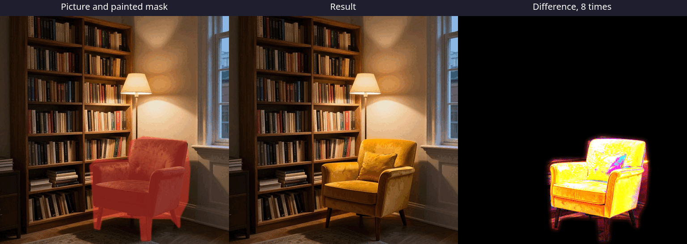
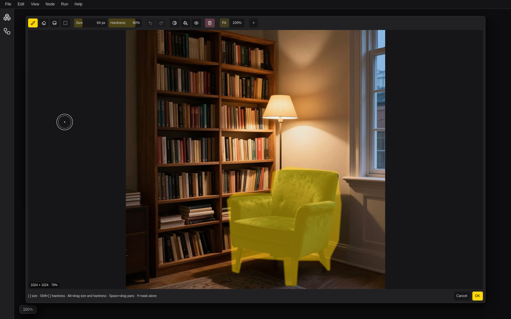
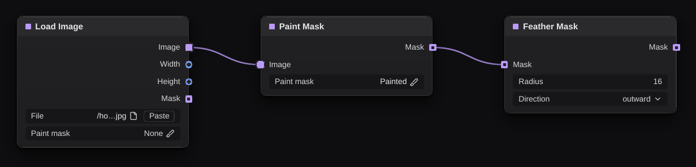
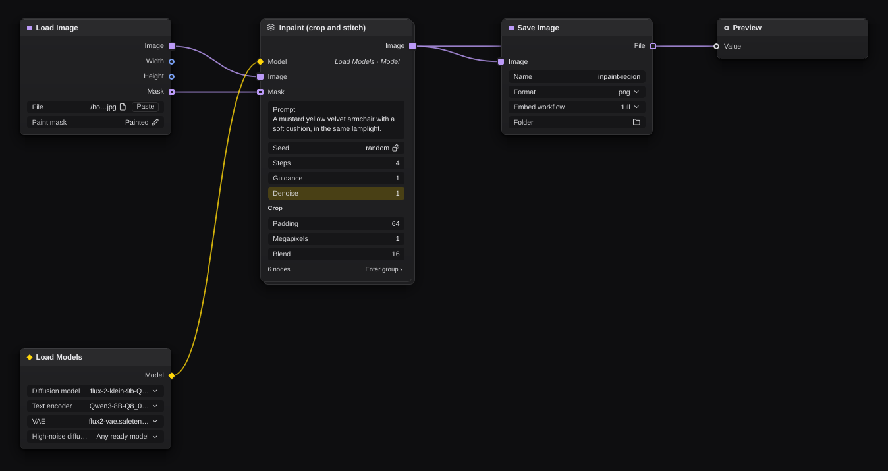
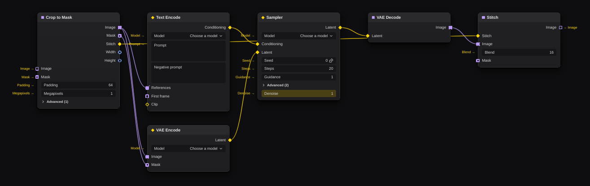
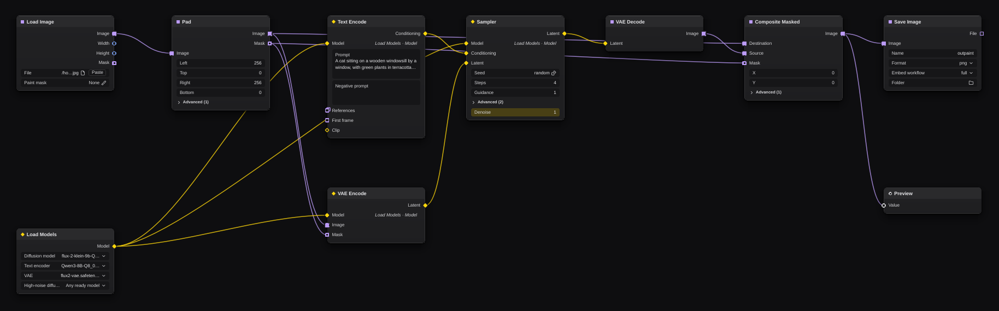

# Masks and inpainting

Everything here is built (#167); the design and its reasons are in
[spec 14.4](spec.md#144-masking-and-inpainting-167).

## What a mask is

A mask is a gray picture the size of the picture it goes with. **White is the part to change,
black the part to keep.** Gray is in between: it softens an edge when the result is put back.
Mask ports are drawn as hollow squares, and picture ports as filled squares.

You get a mask from:

- **Load Image**: paint on it (the Paint mask row on the node). With nothing painted, a picture
  with transparency gives its transparent part as the mask, as in ComfyUI.
- **Paint Mask**: paint over any picture, a generated one too.
- **Pad**: the new border of an outpaint.
- **Solid Mask**, **Image to Mask**, and the mask nodes that change one: Grow Mask, Feather Mask,
  Threshold Mask, Invert Mask, Combine Masks.
- **Apply Mask as Alpha** is the other way round: it puts a mask into a picture's alpha channel, so
  the picture is transparent where the mask is 0 (a cutout). Save it as PNG or WebP to keep it.

## Painting

Paint mask opens the editor at full size. Brush (B) and Eraser (E, or X to swap them) paint with
a round brush: `[` and `]` change its size and Shift with them its hardness, or Alt+drag does
both. Lasso (L) fills a shape you draw, Rectangle (R) a box. I inverts, Shift+Delete clears.
Ctrl+Z and Ctrl+Shift+Z undo and redo each stroke. The wheel zooms, a middle drag or Space+drag
pans, 0 fits and 1 shows 100%. H shows the mask alone. OK keeps the mask, Cancel or Escape drops
what you painted since opening.

The mask is saved as its own file beside your pictures, so the picture itself never changes, and
a saved workflow, a shared package and a template carry it. Paint Mask works the same way over a
picture that comes from another node, a generated one too:

## Change a region: the Inpaint template

File > Browse templates > **Inpaint: change a region**.

1. Put your picture in Load Image and paint over what should change. Paint a little past its edge.
   The template comes with an armchair painted over; click Paint mask to change it.
2. In the group's Prompt, say what should be there ("a mustard yellow velvet armchair").
3. Run. Only the painted part changes. The rest is your picture's own pixels, apart from the
   Blend width around the mask where the two are mixed.

The template's group, **Inpaint (crop and stitch)**, cuts out a box around the mask with room
around it (Padding), redraws that box at about 1 megapixel, whatever the size of your picture,
and puts it back with a soft edge (Blend). So a small region gets the model's full detail, and
no seam shows.

The group's settings, and what the template sets:

| Setting | Template | What it does |
| --- | --- | --- |
| Prompt | what should be there | Text Encode, with the crop as its reference: FLUX.2 Klein then keeps the shape and the light of what is there. Without the reference the new chair lost its legs and its place. |
| Steps, Guidance | 4 and 1 | FLUX.2 Klein is distilled. The group has no default for these, so each model's template sets them. |
| Denoise | 1 | 1 replaces what is under the mask. |
| Padding | 64 px | Room around the mask that the model sees. More gives more context and a smaller region at the same 1 megapixel. |
| Megapixels | 1 | The size the crop is redrawn at. 0 keeps the crop's own size. |
| Blend | 16 px | The soft edge outside the mask. Beyond it the picture is untouched. |
| Seed | random | |

The group is made of six ordinary nodes (Crop to Mask, Text Encode, VAE Encode with the mask, Sampler,
VAE Decode, Stitch). Enter it to change any of them, or ungroup it.

## Extend a picture: the Outpaint template

**Outpaint: extend a picture** adds a border with Pad (256 px on the left and right, feathering
40), redraws only the border, and puts your picture back over the result with Composite Masked
through Pad's mask. The sample picture is 768 px square, so the padded one is about 1 megapixel,
the size FLUX.2 Klein works at. Set how much to add on each side in Pad, and describe the whole
scene in the prompt, not only the new part.

The prompt is not given the padded picture as a reference here. With it, FLUX.2 Klein at 4 steps
copied the gray border and left it gray; without it, the border is drawn from the prompt and the
picture around it. (The inpaint template is the other way: there the reference helps.)

## Tips

- **Seams.** Paint a little past the object, and keep Blend (Stitch) or a Feather Mask before
  Composite Masked. The model works on blocks of 8 or 16 pixels, so the exact edge always comes
  from the blend.
- **Small regions.** Use the crop-and-stitch group (or Crop to Mask and Stitch), not the whole
  picture, so the region is redrawn at the model's resolution. Crop to Mask gives the crop, its mask
  and a stitch handle (the diamond port) that remembers where the crop came from; wire the redrawn
  crop and that handle into Stitch. The crop must keep its shape (to within 2%) or Stitch says so.
  Padding 64 px, 1 megapixel and Blend 16 px are the defaults; Megapixels 0 keeps the crop's size.
- **Denoise.** 1 replaces what is under the mask. Lower keeps its shapes and colors. Below 1, put
  a Fill Masked (blur) before VAE Encode when the old content should not show through.
- **Color shift.** An edit can come back a little lighter, darker or tinted at the seam. Color Match
  (the picture, a reference, and the mask so only the kept part is measured) moves the picture's
  colors to the reference's; put it before Composite Masked or Stitch, and lower Strength to keep
  some of the new color. The reference is the original picture.
- **Wrong way round.** If the rest of the picture changed and the painted part did not, the mask
  is inverted: use Invert in the editor or an Invert Mask node.

## Models

These work with Fugue's helper:

- **Models made for inpainting**, which take the mask themselves: FLUX.1 Fill dev, SDXL Inpaint,
  SD 1.5 and 2 Inpaint, and Flex.2. The helper runs them, but Load Models cannot load them yet:
  it has one text encoder input, and FLUX.1 needs CLIP-L and T5, SD and SDXL CLIP (gap G2 in
  [inpaint-outpaint-research.md](inpaint-outpaint-research.md#7-gaps-in-fugue-proposed-issues-not-filed)).
- **Any other picture model**, where the mask holds the rest of the picture in place at every
  step: FLUX.2 Klein 4B and 9B (the templates use 9B, checked at 4 steps on an RTX 3090: the masked
  part is redrawn and the rest is the picture's own), Qwen-Image Edit, FLUX.1 Kontext, FLUX.1
  dev, Z-Image, SDXL and SD 1.5 (the FLUX.1, SDXL and SD 1.5 ones are not loadable by Load Models
  yet, as above). Which to use for each canvas action, and why, is in
  [inpaint-outpaint-research.md](inpaint-outpaint-research.md).

Video models take no mask. Generate Image takes a mask only from a provider that supports one,
and otherwise says so (`mask_unsupported`, naming the models that can). Today that is an Omarchy
model whose sd-server lists `mask_image`; the Fugue helper redraws through the staged nodes (VAE
Encode with a mask, then a Sampler) instead. The mask must be the size of the start image, and the
result is put back over the start image through it, so everything outside the mask is the start
image's, to the pixel; put a Feather Mask in front for a soft edge.

**Soft mask (gray as a strength).** The Sampler's advanced input *Soft mask* reads the mask's gray as how
much to change (differential diffusion): white is redrawn from the first step, black is kept, and a gray
cell is held to the picture until late in the run, so a 25% gray changes only a little. It gives smooth
transitions with no seam, where a hard mask plus Feather Mask puts a softened picture back. It needs a
latent from VAE Encode with a mask, and it does nothing for an inpaint model (FLUX.1 Fill, SDXL Inpaint),
which reads its mask as white or black. Off, gray is rounded to white or black as before.

## Remove a background

The pack **Remove Background** makes the mask for you: it finds the subject of a picture and gives it as a
mask (white is the subject, soft at its edge). It has two parts, both in the node menu under Image > Mask:

- The group **Remove Background**: a picture in, the **cutout** out (the same picture with a transparent
  background, RGBA) and the **mask**. Save the cutout as PNG or WebP (Save Image keeps the transparency). Its
  advanced inputs are Threshold (hard edge) and Edge shrink (pixels the edge is pulled inward and softened, to
  lose a fringe of the old background). Inside it are three plain nodes you can open with Tab: Remove Background
  Mask, Feather Mask and Apply Mask as Alpha. The template **Remove background** (Load Image, the group, Preview,
  Save Image) is the quickest start; opening it offers to install the pack.
- The node **Remove Background Mask**: only the mask. Wire its `mask` to the Inpaint group, Crop to Mask or
  Composite Masked like any other mask; **Invert** gives the background instead, to redraw everything but the subject.

Without the pack a workflow that uses the group opens, says plainly that the pack is missing and offers to
install it; nothing runs until it is installed.

It is an optional pack (Fugue's own program links no machine-learning code). Install it from
Settings > Packs or with `fugue pack add examples/packs/io.github.bmaltais.fugue-remove-background`. The setup
command it shows, `uv sync --no-dev --extra cpu`, makes a Python environment in the pack's folder with ONNX
Runtime (needs [uv](https://docs.astral.sh/uv/) and the network). For an NVIDIA GPU run
`uv sync --no-dev --extra cuda` in that folder instead and keep Device on Auto (it needs CUDA and cuDNN installed).

The model is not part of the pack. Open the node's Model picker: under Download it lists
**BiRefNet general, Swin-T** (224 MB, about 10 s for a 1 megapixel picture on a CPU) and **Swin-L** (973 MB, finer
edges, about 16 s). Picking one asks first, naming the licence (MIT, credit to the authors, commercial use
allowed), the size, the host (github.com) and the folder, and downloads only when you say so. A BiRefNet
`.onnx` file of your own goes in the `birefnet` models folder.

It needs about 8 GB of memory while it runs and frees it a minute after the last run. Threshold (advanced)
makes the edge hard: 0 keeps the soft edge, 0.5 cuts at half. For a cleaner seam, follow it with Grow Mask or
Feather Mask. The pack's folder has its own README with the tests.

## Select an object by points or a box

The pack **Segment by Points or Box** cuts one object out of a picture and gives it as a mask (white is the object,
with a clean edge). It is SAM 2.1, an optional pack like Remove Background: install it from Settings > Packs or with
`fugue pack add examples/packs/io.github.bmaltais.fugue-segment`; the setup command, `uv sync --no-dev --extra cpu`,
makes its own Python environment (`--extra cuda` for an NVIDIA GPU). The node is in the node menu under Image > Mask.

Say which object with the node's three text inputs, in **pixels from the picture's top left** (x goes right, y goes down;
the picture's size is on its node):

| Input | What goes in it |
| --- | --- |
| Include points | One point per line, `x y`, inside the object. Add one on each part the first mask missed. |
| Exclude points | One point per line, `x y`, on what must stay out (the shadow, the object next to it). |
| Box | `x1 y1 x2 y2`: two opposite corners of a box around the object. With a box the points are optional. Several lines are several objects, joined in one mask (then leave the points empty): this is how Find by Text's boxes arrive. |

You need a Box or at least one Include point. A box and points together refine each other. The text inputs can also be
wired from other nodes, so a script or another node can give the points. There is no picker on the node's face yet (click the
picture to add a point is a later slice, since a pack cannot ship interface code); read the pixel position from the
picture's large view.

The model is not part of the pack. Open the node's Model picker: under Download it lists **SAM 2.1 tiny** (117 MB) and **SAM 2.1
base+** (272 MB, finer edges). Picking one asks first, naming the licence (Apache-2.0, credit to Meta and the exporter,
commercial use allowed), the size, the host (huggingface.co) and the folder, and downloads only when you say so. A
bundle of your own (`.zip` with an encoder and a decoder, as in the same repository) goes in the `sam2` models folder.

On a CPU the tiny model looks at a picture in about a second (base+ about 2.5 s); the node keeps what it saw, so changing the
points or the box and running again takes a twentieth of a second. It needs a few GB of memory while it runs and frees it a minute
after the last run. Invert gives everything but the object. Soft edge (advanced) gives the model's confidence instead of a hard
edge. For a cleaner seam, follow it with Grow Mask or Feather Mask. The pack's folder has its own README with the tests.

## Select by words

To cut out what you can name, use two nodes of the same pack, **Find by Text** then **Segment by Points or Box**
(both under Image > Mask; one install, `fugue pack add examples/packs/io.github.bmaltais.fugue-segment`). Find by Text
looks for what you name and gives a **box** around each match; Segment turns the boxes into the mask. Wire Find by Text's
`Boxes` to Segment's `Box` and leave Segment's points empty: each box is one object, and the mask is all of them together.

| Find by Text | What goes in it |
| --- | --- |
| Query | What to find, in a few words: `red balloon`. Several things: `glove, red balloon` (periods, commas and new lines separate). A short noun phrase works best. |
| Threshold | How sure the model must be, 0.05 to 0.95 (default 0.3). Lower finds more and more wrong ones; higher keeps the clear matches. |
| Most matches (advanced) | Keep only this many, the best first. 0 keeps all. Use 1 for "the clown", 0 for "every glove". |

The `Preview` output is the picture with each box, its phrase and its score drawn on it: look at it to choose the threshold. When nothing
matches, Boxes is empty and Segment says it has nothing to segment.

The model is not part of the pack. Open Find by Text's Model picker: under Download it lists **GroundingDINO tiny** (360 MB,
half precision, the same boxes as the full-precision file) and the full-precision file (719 MB). Picking one asks first,
naming the licence (Apache-2.0, credit to IDEA-Research and the exporter, commercial use allowed), the size, the host
(huggingface.co) and the folder. A GroundingDINO `.onnx` file of your own goes in the `grounding-dino` models folder (the `.pth`
checkpoints of ComfyUI's custom node, which may sit in the same folder, are not read).

It looks once for each phrase: about a second each on an NVIDIA GPU, about 4 s on a CPU. It does best on one clear thing ("the dog",
"a red mug", "glove"), and finds each of several ("tree") but takes a whole thicket for one tree when they overlap: raise the threshold
until the Preview shows one box on each, or give Segment a box or points of your own. It follows names it knows, not
positions ("the left one") or reading text. The first stage gives only boxes, so Boxes can also feed a crop or a script.

## From the command line

`fugue workflow new my.fugue --template inpaint-region` writes the template with its picture and
mask beside it; `fugue run my.fugue --wait` runs it. Change the prompt with
`--set inpaint.prompt="..."`. The painted mask is a file in `inputs/` like the picture, so
`--set load.mask=inputs/other-mask.png` changes it (an 8-bit gray PNG, white is redrawn).

## Not yet

Clicking the picture to place the points is a later slice. Color matching for outpaints, and a paint canvas with layers are later issues.
